import { Steps, Tabs, TabItem } from '@astrojs/starlight/components';

## First Login

You can use CloudTAK in a web browser on a computer, or in the CloudTAK app on a phone or tablet.

Prefer to watch? [Getting Started with CloudTAK Mobile](https://vimeo.com/1240956751) (11 minutes) walks you through downloading the app, logging in and finding your way around the map.

### Get the CloudTAK App

Skip this section if you are using CloudTAK in a web browser.

<Tabs syncKey="platform">
  <TabItem label="iPhone and iPad" icon="apple">
    Get [CloudTAK on the App Store](https://apps.apple.com/us/app/cloudtak/id6773467848), or scan this code with your iPhone or iPad camera.

    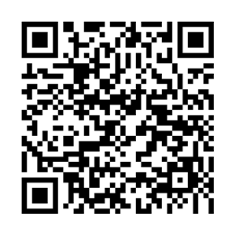
  </TabItem>
  <TabItem label="Android" icon="mobile-android">
    Get [CloudTAK on Google Play](https://play.google.com/store/apps/details?id=io.cloudtak.app), or scan this code with your Android phone or tablet camera.

    
  </TabItem>
</Tabs>

### Connect and Log In

<Steps>

1. Open CloudTAK and connect to your agency's server.

    - **In a web browser:** go to your agency's CloudTAK address. Your administrator can give it to you.
    - **In the CloudTAK app:** the first time you open the app, the **Connect to Server** screen appears. Choose your agency from **Known Providers**, or select **Manual Entry** and type the server address your administrator gave you.

    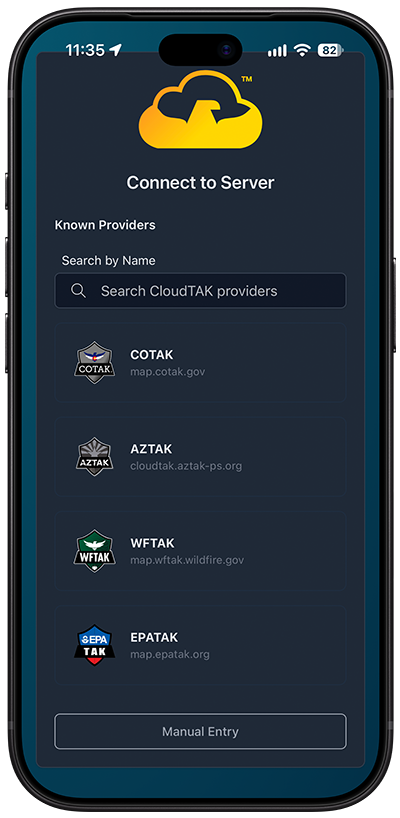

2. Log in with your agency credentials.

    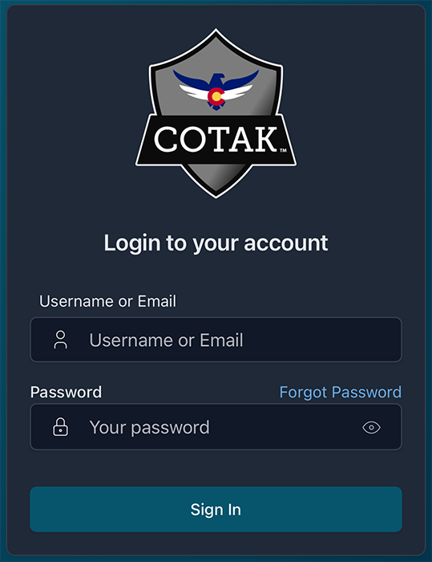

</Steps>

**Changing servers in the app:** log out, select the gear icon in the bottom right corner of the login screen, then select **Switch Servers**.

### Set Up Your Profile

The first time you log in, the **Welcome to CloudTAK** window asks who you are. You can change these later in Settings.

- **Callsign:** the name other users see for you on the map. We recommend this convention: `[Agency Acronym] [Last Name] [Radio Callsign]`.
- **Team:** sets the color of your marker on the map. Choose the color for your agency type, shown in the chart below.
- **Role:** when in doubt, choose **Team Member**.
- **Phone Number:** optional. It is shared with other users on your channels.

Select **Get Started** when you are done.

### Allow Location and Notifications

After you set up your profile, the **Permissions** window asks to use your **Location** and send you **Notifications**. The steps are different on each device, so select yours below. To set these up later, select **Skip for now** and turn them on in Settings.

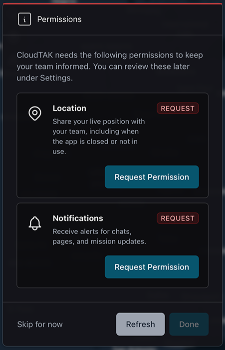

<Tabs syncKey="platform">
<TabItem label="Web Browser" icon="laptop">

<Steps>

1. Select **Request Permission** under **Location**.

2. Read how CloudTAK uses your location, then select **Agree and continue**.

3. When your browser asks to know your location, select **Allow while visiting the site**. Some browsers just show **Allow**.

    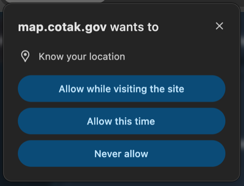

4. Select **Request Permission** under **Notifications**. When your browser asks to show notifications, select **Allow**.

    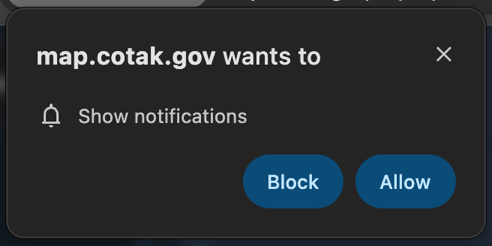

5. When both show **Allowed**, select **Done**.

</Steps>

</TabItem>
<TabItem label="iPhone and iPad" icon="apple">

<Steps>

1. Select **Request Permission** under **Location**.

2. Read how CloudTAK uses your location, then select **Agree and continue**.

3. Leave **Precise** on and select **Allow While Using App**.

    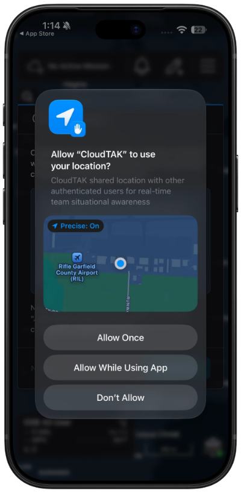

4. On the **Background location** screen, select **Agree and continue**.

5. Select **Change to Always Allow** so your team can still see you when the app is closed.

    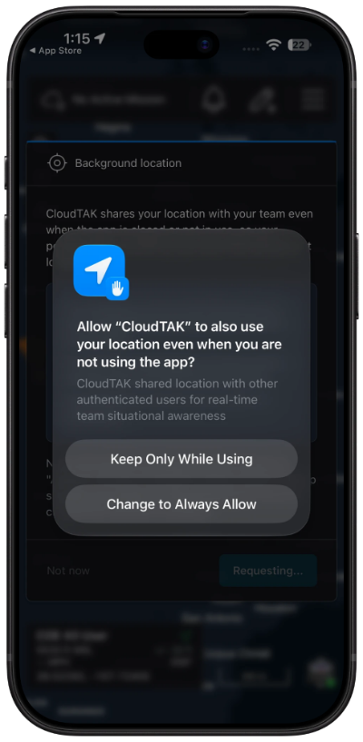

6. Select **Request Permission** under **Notifications**, then select **Allow**.

7. When both show **Allowed**, select **Done**.

</Steps>

</TabItem>
<TabItem label="Android" icon="mobile-android">

<Steps>

1. Select **Request Permission** under **Location**.

2. Read how CloudTAK uses your location, then select **Agree and continue**.

3. Select **Precise**, then select **While using the app**.

    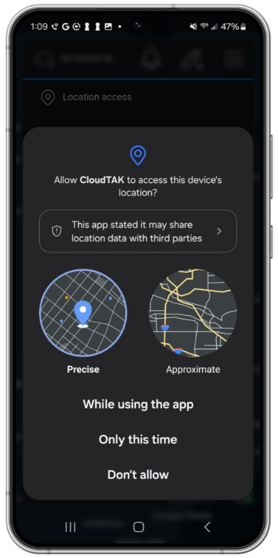

4. On the **Background location** screen, select **Agree and continue**.

5. In the settings page that opens, select **Allow all the time** so your team can still see you when the app is closed. Scroll down and make sure **Use precise location** is on, then go back to CloudTAK.

    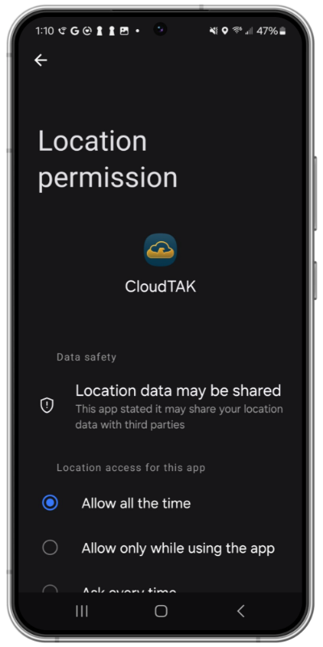

6. Select **Request Permission** under **Notifications**, then select **Allow**.

7. When both show **Allowed**, select **Done**.

</Steps>
</TabItem>
</Tabs>

### Check Your Location

Once you are on the map, check that your location is right. Phones and tablets with cellular service find it with GPS. On a computer, your location may be missing or only approximate. To see how accurate it is or to set it by hand, see [Location & Coordinates](#location--coordinates).

Once you're set up, see [Moving Around the Map](#moving-around-the-map) to learn the basics.

## Moving Around the Map

Use a mouse on a computer, or touch gestures on a phone or tablet.

| | Mouse | Touchscreen |
| --- | --- | --- |
| Move the map | Click and drag | Drag with one finger |
| Zoom in and out | Scroll the mouse wheel, or use the plus and minus buttons in the top right corner | Pinch with two fingers |
| Rotate | Hold Ctrl, then drag left or right | Twist two fingers |
| Tilt | Hold Ctrl, then drag up or down | Drag two fingers up or down |

On a phone, the plus and minus zoom buttons are hidden to save space. To show them, open **Settings**, then **Display Preferences**, and set **Display Zoom Controls** to **Always**.

### Searching the Map

 To find a place, select the search button on the left side of the map. On a computer you can also press Ctrl+F (⌘+F on a Mac). Search for an address the way you would in a navigation app, or for coordinates, overlays or another user's callsign. Select a result and the map moves to that location.

## Location & Coordinates

Everything about your own location is in the GPS panel in the bottom left corner of the map.

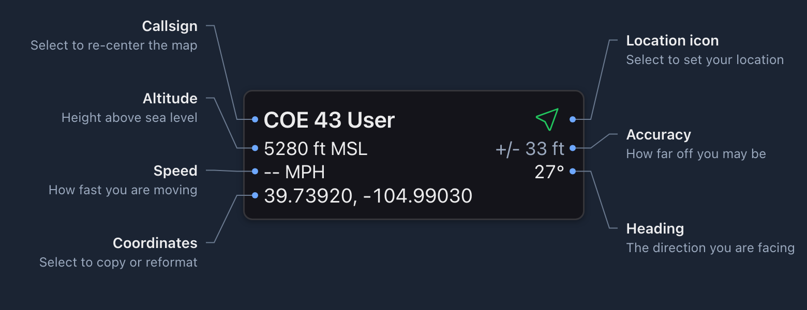

### Callsign

Your callsign is at the top of the panel. Select it at any time to move the map back to your location.

### Location Icon

The icon next to your callsign shows where your location comes from:

-  **Live GPS, green:** accurate to within 50 m (about 165 feet).
-  **Live GPS, yellow:** accurate to within 200 m (about 650 feet).
-  **Live GPS, red:** more than 200 m off.
-  **Manual location:** a position you placed on the map yourself.
-  **No location:** CloudTAK doesn't know where you are and you will not appear to other users. This icon also shows briefly while your device finds your location.

The icon is also the button for setting your location by hand.

### Set Your Location

If your location is missing or wrong, set it by hand:

<Steps>

1. Select the location icon  in the top right corner of the GPS panel.

2. A prompt at the bottom of the map says **Click on the map to set your location**. Select your location on the map.

    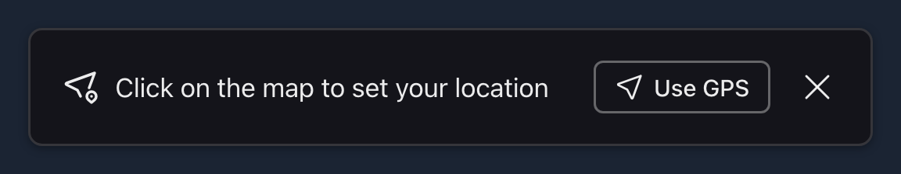

</Steps>

The icon changes to a pin to show that you set your location by hand. To go back to your device's GPS, select the icon again, then select **Use GPS**. To close the prompt without changing anything, select the **X**.

### Altitude, Accuracy, Speed and Heading

The middle of the panel shows:

- **Altitude:** your height above mean sea level (MSL).
- **Accuracy:** the `+/-` value, how far off your location may be. Phones use GPS and are usually accurate to within about 30 feet. Computers often don't have GPS, so the browser may estimate your location and it can be much less accurate.
- **Speed:** how fast you are moving. Altitude and speed only show while your location comes from live GPS.
- **Heading:** the direction you are facing, from your device's compass when it has one, or the direction you are moving.

To change the units, open **Settings**, then **Display Preferences**, and set **Distance Unit**, **Elevation Unit** and **Speed Unit**.

### Coordinates

The bottom of the panel shows your coordinates. Click them to open the coordinate menu:

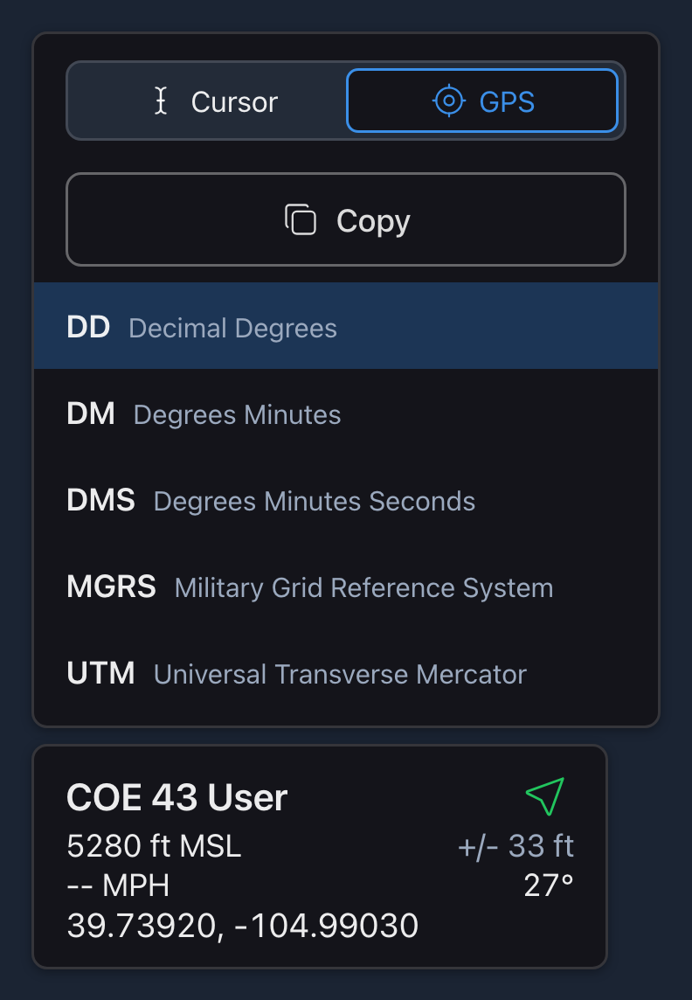

- **Cursor / GPS** (web only): switch between the position of your mouse cursor and your own location. This switch doesn't appear in the mobile apps, which always show your own location.
- **Copy**: copy the coordinates in the current format, ready to paste into a radio log, CAD or chat.
- **Format**: pick DD, DM, DMS, MGRS or UTM. Your choice is saved to your profile.

Coordinate format examples

| Format | Example |
| ------ | ------- |
| DD | `39.7392, -104.9903` |
| DM | `39° 44.3519', -104° 59.418'` |
| DMS | `39° 44' 21.11", -104° 59' 25.08"` |
| MGRS | `13S ED 00831 98811` |
| UTM | `13S 500831 4398811` |

## Drawing Tools

Use the drawing tools to put points, lines, shapes and photos on the map.

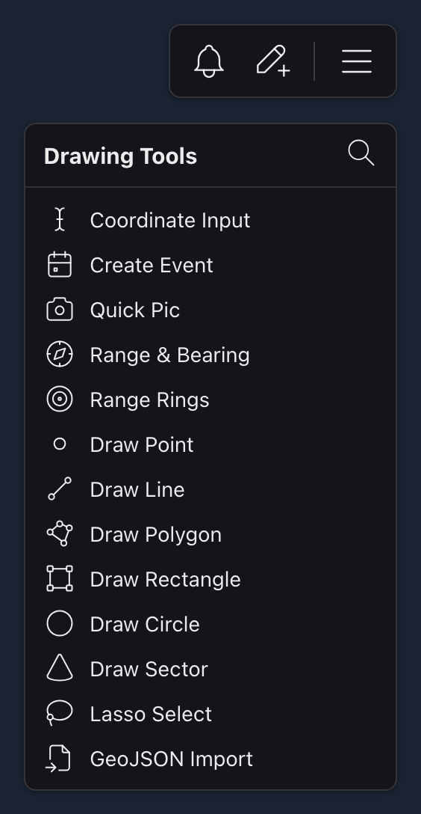

Select the pencil icon  in the top right corner to open the menu, then select a tool. To find a tool quickly, select the search icon and type its name.

While you draw, a bar at the bottom of the map shows the tool you're using. Select the check mark to finish, or the **X** to cancel. When you finish, the new feature's details pane opens so you can name and style it.

Drawing works a little differently with a finger than with a mouse, because the map can't see your finger until it touches the screen. Each tool below says what to do on a computer and on a phone or tablet. On a phone, tools with their own pane, such as Coordinate Input and Range Rings, open it as a full-screen window instead.

### Coordinate Input

Place a point at coordinates you type in. Enter a name and the coordinates in any format (DD, DM, DMS, MGRS or UTM), choose the point type, then select **Create Point**.

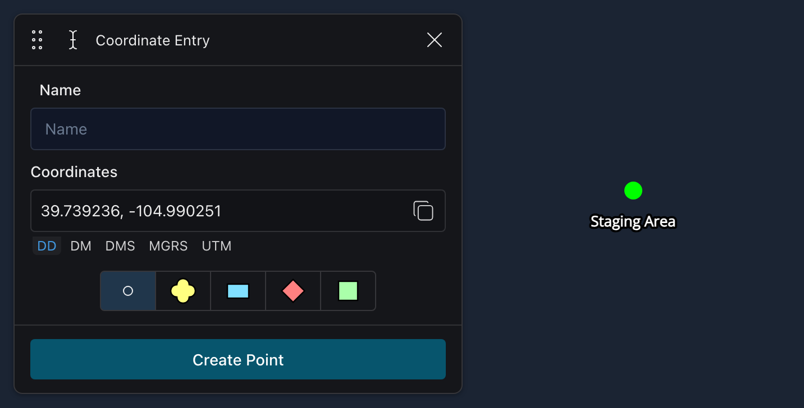

### Create Event

Start a shared record of an incident, such as a wildfire or a search, that your team can work from together.

An event is more than a marker. It's kept on the CloudTAK server and shared with the channels you choose, so everyone on those channels sees it on their map, including people using other TAK apps. Each event keeps track of its own priority, start and end times, the people assigned to it, and any linked missions, links and forms, so it can be the one place everyone checks during an incident.

**Events are in beta**, so how they work may change between releases.

<Steps>

1. Select **Create Event** from the Drawing Tools menu. You can also select **Create Event** at the top of the Query Mode panel to start one at a spot on the map, with its address filled in. See [Working with Map Features](#working-with-map-features).

2. Fill in the event:

    - **Name** (required): what the event is called, such as "Grass Fire".
    - **Priority:** **none**, **low**, **medium**, **high** or **critical**.
    - **Type:** the symbol the event shows on the map. It starts as a friendly **Incident**. See the next step to change it.
    - **Coordinates:** where the event is. This starts at the center of the map, and you can type coordinates in any format.
    - **Location:** an address or place name.
    - **Remarks:** any notes, with bold, lists and links if you need them.
    - **Share to Channels** (required): choose at least one channel. Only channels you have turned on are listed.

    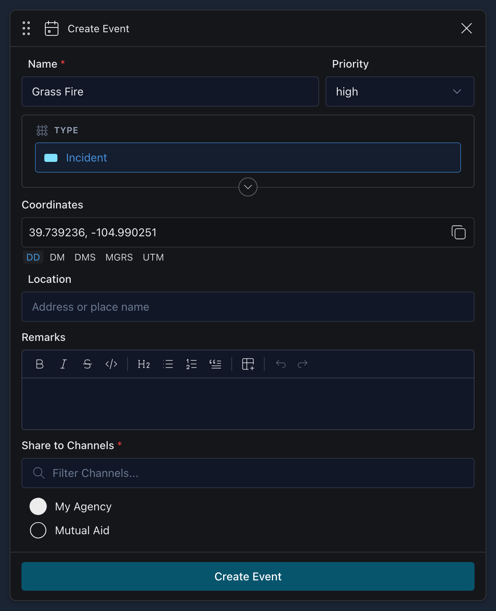

3. To change the type, select **Type**. This is the same symbol picker as on a marker's details:

    - **Affiliation:** the menu next to **Filter**. Choose **Friendly**, **Hostile**, **Neutral**, **Unknown** or another affiliation. The symbol's frame and color change to match.
    - **Status:** **Present**, **Planned**, **Fully Capable**, **Damaged**, **Destroyed** or **Full to Capacity**.
    - **Symbol:** type in **Filter** to search every symbol, or browse the symbol sets and select one.

    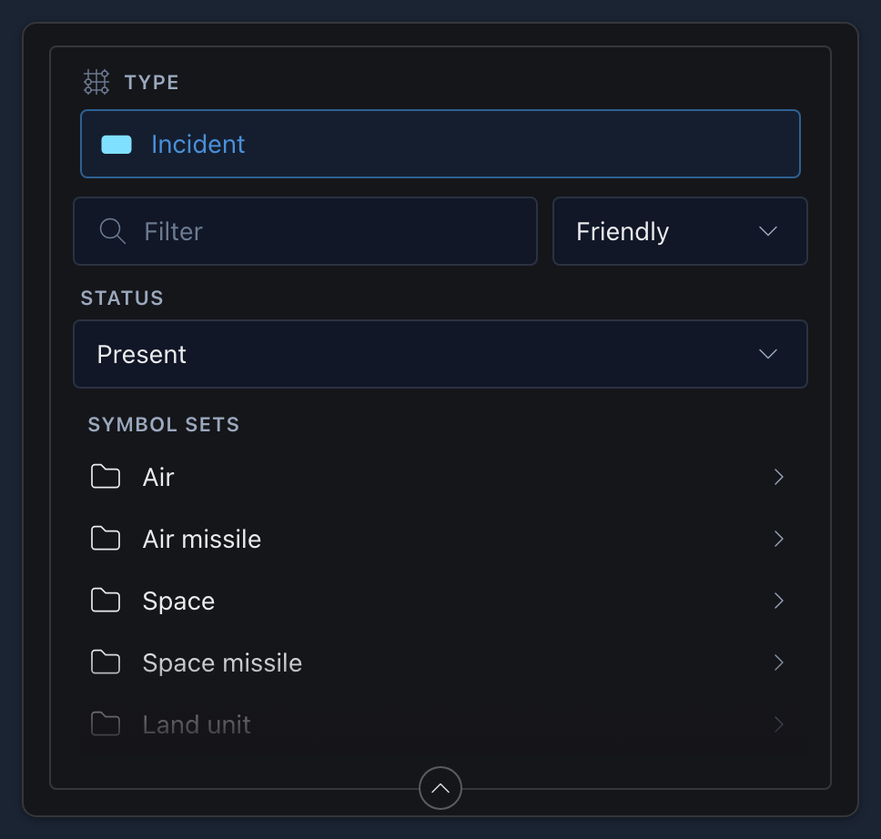

    If your administrator has set up event types, you choose one of those instead, or **Other** to use the picker.

4. Select **Create Event**. The button stays greyed out until the event has a name and at least one channel.

</Steps>

The new event opens in its own pane. From there you can:

- **End** the event when it's over, or **Reactivate** it later.
- Move its marker, zoom to it, or delete it.
- Choose whether other people can edit it.
- Add the people managing it under **Assignments**, each with a role such as Incident Commander.
- Link it to Data Sync missions, add links, and fill out forms under **Forms**.

You'll find every event you can see under **Menu** → **Features** → **Events**.

### Quick Pic

Take a photo and drop a marker with the photo attached at your current location, or at the center of the map if CloudTAK doesn't know where you are. Select **Take Photo**. On a phone or tablet this opens the camera.

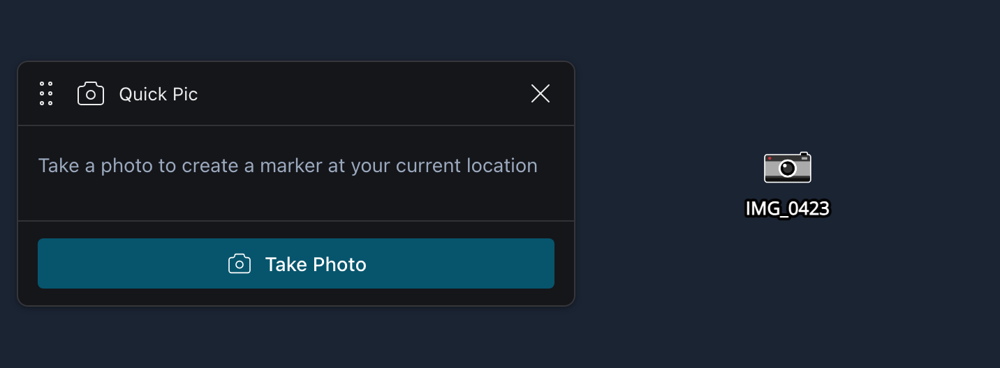

### Range & Bearing

Draw a line from a starting point at a bearing and distance you choose. Enter a name, the starting coordinates in decimal degrees, the bearing and the distance, then select **Create Range & Bearing**.

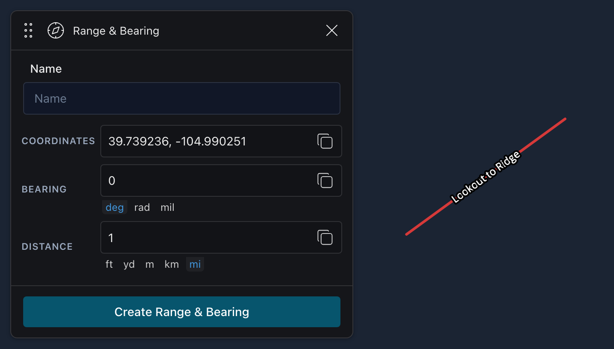

### Range Rings

Draw rings at set distances around a point. Useful for evacuations, searches and manhunts. Enter a name and the origin, set the diameter of each ring (select **Add Ring** for more), and choose the color, opacity and line width.

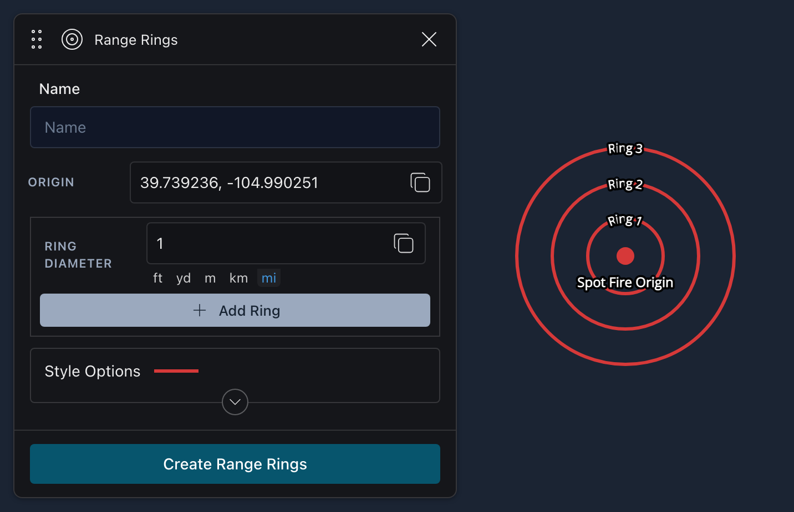

### Draw Point

Choose the point type in the bar at the bottom of the map (Custom Point, Unknown, Friendly, Hostile or Neutral), then click the map to drop the point, or tap it on a phone or tablet.

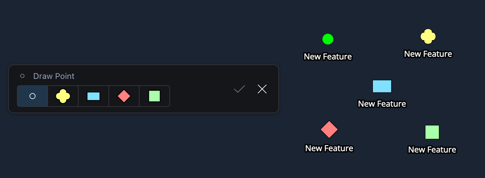

### Draw Line

- **Computer:** click the map to add each point along the line. To finish, click the last point again, press **Enter**, or select the check mark.
- **Phone or tablet:** tap to add each point. The line doesn't follow your finger between taps, so each section appears when you tap. To finish, tap the last point again or select the check mark.

To follow roads and trails instead of drawing straight sections, choose a snapping layer from the menu in the bar at the bottom of the map. It starts as **No Snapping**, and the layers you can choose depend on your server. On a phone, the menu is under **More**.

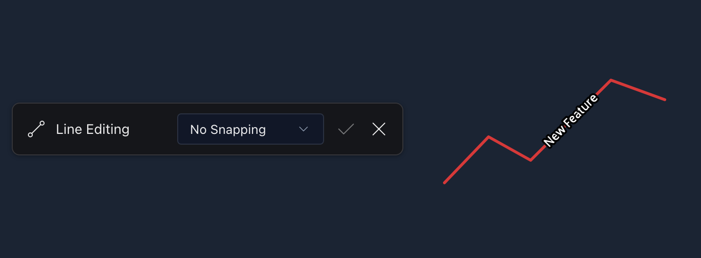

### Draw Polygon

Draw any shape with three or more corners.

- **Computer:** click the map to add each corner. To close the shape, click the first corner again, press **Enter**, or select the check mark.
- **Phone or tablet:** tap to add each corner, then tap the first corner again or select the check mark.

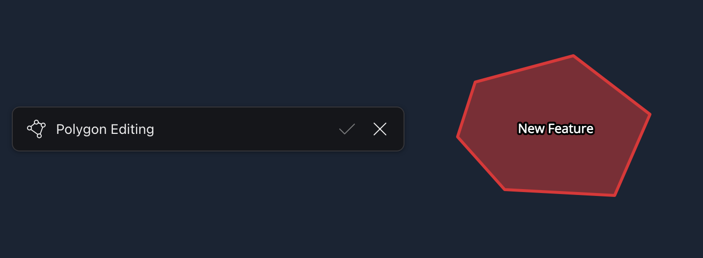

### Draw Rectangle

Draw a rectangle at any angle.

- **Computer:** click two corners to set the length and angle of one side. Move the pointer to either side to set the width, then click a third time.
- **Phone or tablet:** tap two corners for one side, then tap where the opposite side should be. The rectangle appears when you tap, rather than following your finger.

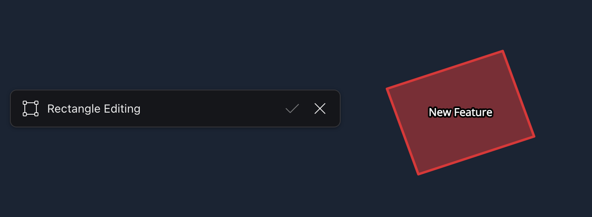

### Draw Circle

- **Computer:** click the center, move the pointer out to the size you want, and click again. You can also press at the center and drag out.
- **Phone or tablet:** press and hold the center of the circle, drag your finger out to the size you want, then lift your finger.

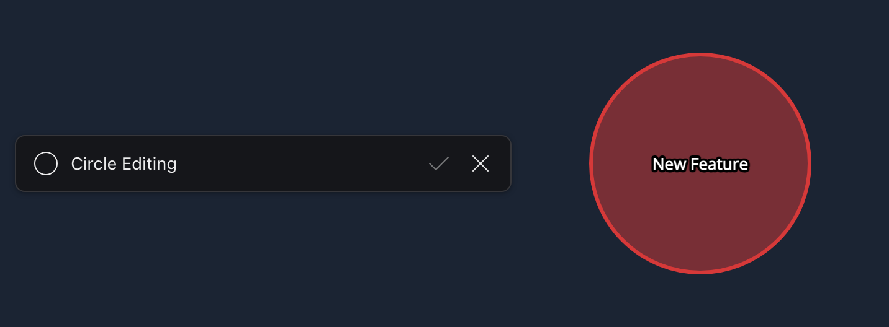

### Draw Sector

Draw a wedge, such as a search area or a camera's field of view.

- **Computer:** click the center. Click again to set how far the wedge reaches and where one side starts, then move the pointer around to sweep the wedge open and click a third time to set the other side.
- **Phone or tablet:** tap the center, tap where one side of the wedge should end, then tap where the other side should be.

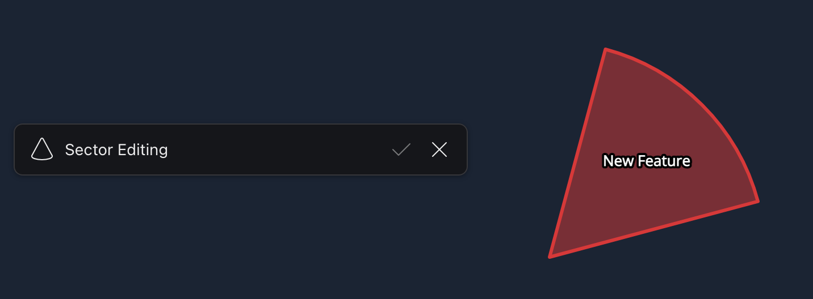

### Lasso Select

Select several features at once. First choose where to select from in the bar at the bottom of the map: **Map Features**, or one of your overlays. On a phone, this is under **More**.

- **Computer:** click to start the loop, move the pointer around the features you want, and click again to finish. You can also press and drag.
- **Phone or tablet:** press and drag your finger around the features you want, then lift your finger to finish.

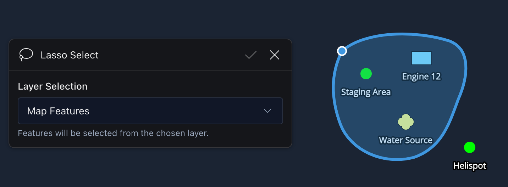

When you finish, the features inside the loop are listed in a **Selected Features** menu in the bottom left corner of the map. From there you can:

- **Share** the features with other users.
- Select the three dots for more options: **New Data Package**, **Move to Data Sync**, or **Delete Features**.
- Select the trash can next to a feature to take it out of the selection. This doesn't delete it from the map.

**Delete Features** takes every selected feature off your map. Features that only exist on your map, like the ones you've drawn, are gone for good. Features that are syncing to your map from somewhere else, like another user's icon or an aircraft, come back the next time they update.
- Select the **X** to close the menu and clear the selection.

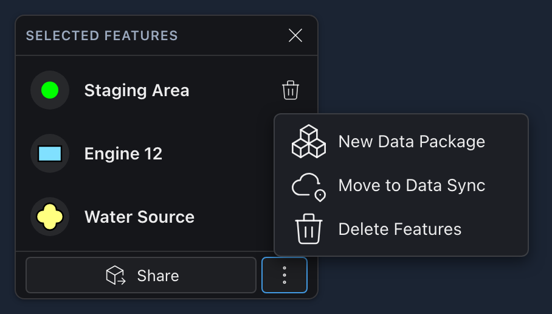

### GeoJSON Import

Add a small GeoJSON file (.json or .geojson) to the map. After you choose the file, CloudTAK lists the features it found. Select **Create Features** to add them. They show up in **Your Features** and can each be edited, but they are features on your map rather than an overlay, so you can't toggle them on or off. Upload large files through **Imports** instead.

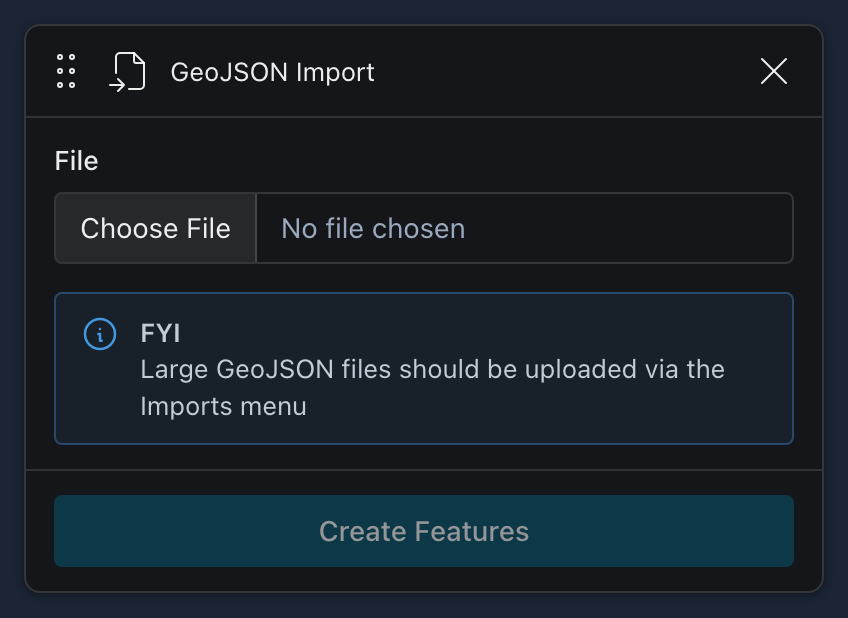

### Editing What You've Drawn

To move, edit, delete or share anything you've drawn, select it on the map. See [Working with Map Features](#working-with-map-features).

## Working with Map Features

Everything on the map, from other users and aircraft to markers, shapes and overlay data, can be selected for more information.

### The Radial Menu

Click a feature, or tap it on a phone or tablet, to open its radial menu. Which options appear depends on what the feature is and your permissions:

-  **Edit:** change the shape or move the point by dragging it. For your own features, and Data Sync features where you have write access. Other users' positions can't be edited.
-  **Delete:** remove the feature from your map. Data Sync features can only be deleted with write access, and are then removed for everyone subscribed.
-  **Lock On:** points only. The map follows the feature as it moves, which is useful for vehicles, aircraft and GPS trackers.
-  **Play:** shown when the feature has a video stream attached.
-  **Geometry:** opens a second ring with more options, shown below.
-  **View:** open the feature's details pane.

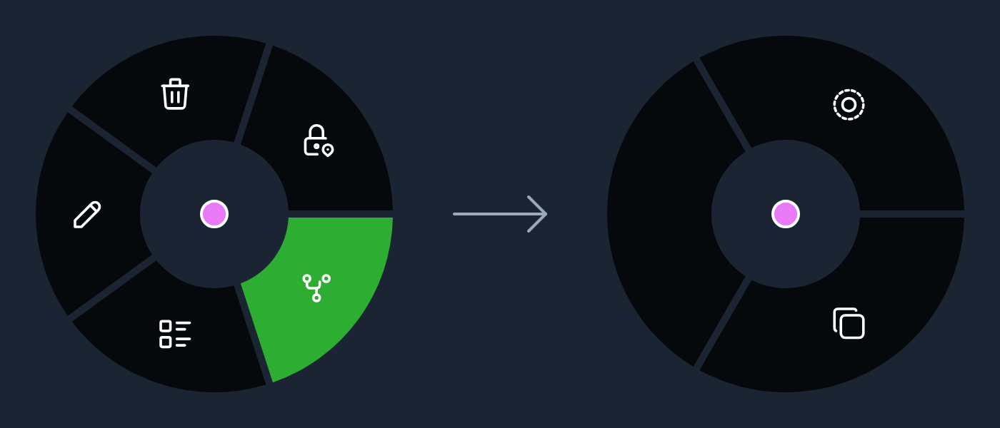

The **Geometry** ring has:

-  **Buffer:** draw a perimeter at a distance you choose around the feature.
-  **Copy:** copy the point so you can paste it somewhere else on the map, from the menu below. Only points can be pasted for now.
-  **Split:** lines only. Split the line in two at the spot you clicked.

Select the center of the ring to go back.

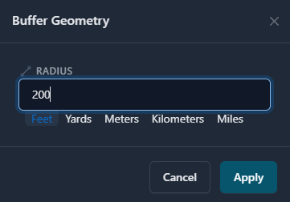
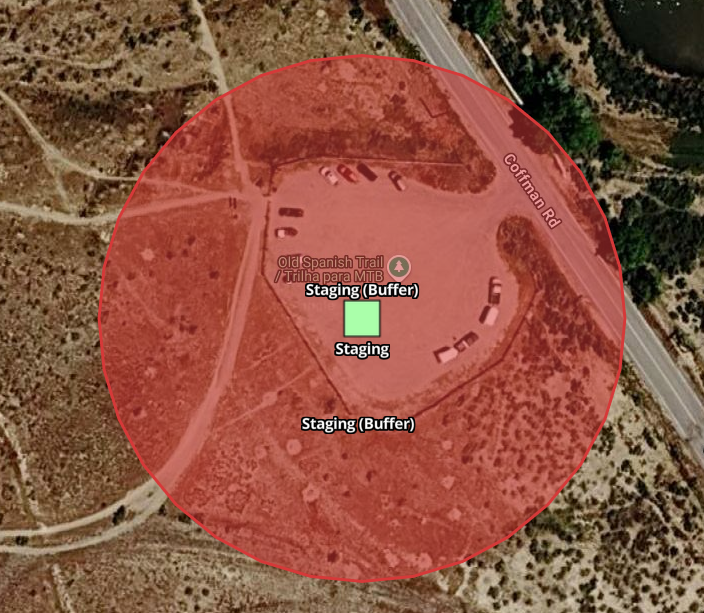

Overlay data, such as features from an overlay or base map, shows a shorter menu: **View**, and  **Cut** when the overlay allows it, which copies the feature onto your map as your own feature.

When several features overlap where you click, a list appears so you can pick the right one. Hold **Ctrl** while clicking to add a feature to a multi-selection.

**On an empty spot of the map**, right-click, or press and hold on a phone or tablet, to open a different radial menu:

-  **New Feature:** drop a point here.
-  **Paste:** only shown when you have copied a point. Pastes it here.
-  **Info:** open Query Mode for this spot. See [Querying a Point on the Map](#querying-a-point-on-the-map) below.

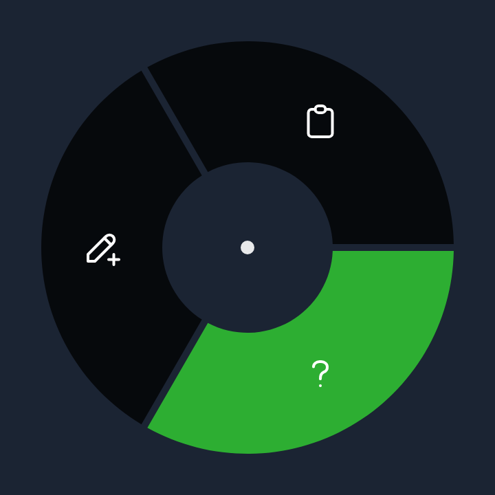

### Querying a Point on the Map

Query Mode gives you information about any spot on the map without placing a marker.

<Steps>

1. Right-click an empty spot on the map, or press and hold on a phone or tablet, then select **Info** .

2. The Query Mode panel shows:

    - **Coordinates** of the spot, switchable between formats
    - **Location**: the nearest address or place name
    - **Elevation**, when elevation data is available for the area
    - **Weather** from the National Weather Service: wind, humidity, dewpoint and precipitation. US locations only.
    - **Sun Phase**: sunrise, sunset and twilight times, with the current local time
    - **Magnetic Declination**: the difference between true and magnetic north, needed for compass bearings

    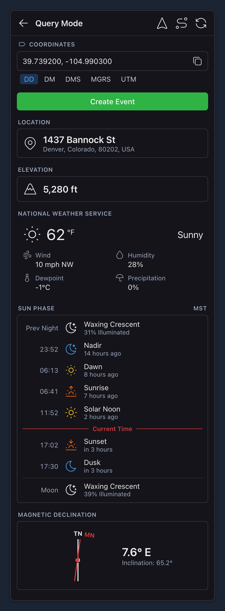

3. From the buttons at the top of the panel you can **Navigate** to the spot, **Create Route** to it, or **Refresh** the information. **Create Event** starts a new event at this location, pre-filled with the address.

</Steps>

### The Details Pane

The details pane opens from **View** . The buttons along the top are:

- **Save Feature** (star): keep the feature on your map, so it doesn't disappear when it stops updating
- **Zoom To**: center the map on the feature
- **Navigate**: points and routes only, see below
- **Lock On**: points only. The map follows the feature as it moves.
- **View Video Stream**: when the feature has video
- **Share**: see below
- **Breadcrumb**: points only. Show a **Live Trail**, or **Load History** for the last 1, 4, 8 or 24 hours.
- **Edit**: change the shape or position
- **Transforms**: **Buffer**, or **Convert to Route** for lines
- **Chat**: start a chat with another user
- **Add Properties** (three dots): attach files, links, a video stream, a sensor field of view, or a geofence (polygons only)

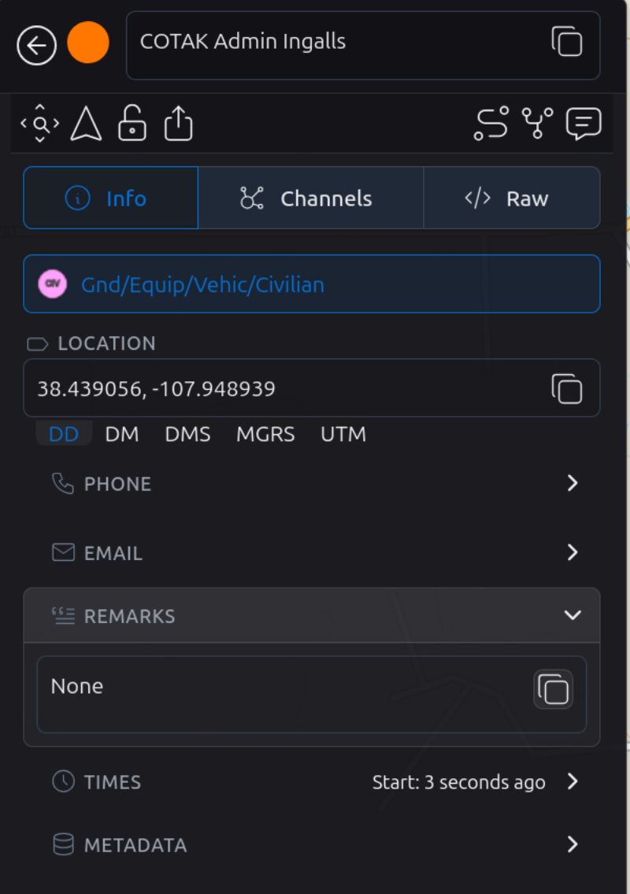

Below the buttons, the **Info** view shows everything known about the feature: its type, the Data Sync it belongs to, location, elevation, speed and course, contact details, remarks, attachments, links, sensor readings, style and who created it.

To change a point's icon, go to **Style** in the Info view and select **Select Icon** next to **Icon**. Choose an icon set from the menu, or search for an icon by name. CloudTAK has many icon sets, but other TAK apps may not support the specialty ones and often show those icons as a yellow clover instead.

Use the switch at the top to change to **Raw** to see the underlying data. For other users, **Channels** shows which channels they are on.

### Sharing Features

<Steps>

1. Open the feature's details pane and click **Share**. You can also share several features at once from a Lasso selection (see [Drawing Tools](#drawing-tools)).

2. In the **Share Features** window, choose who receives it from the **Users**, **Channels** or **Data Syncs** tabs, then click **Share**.

    **Broadcast To All Users** sends the feature to everyone on your active channels instead.

    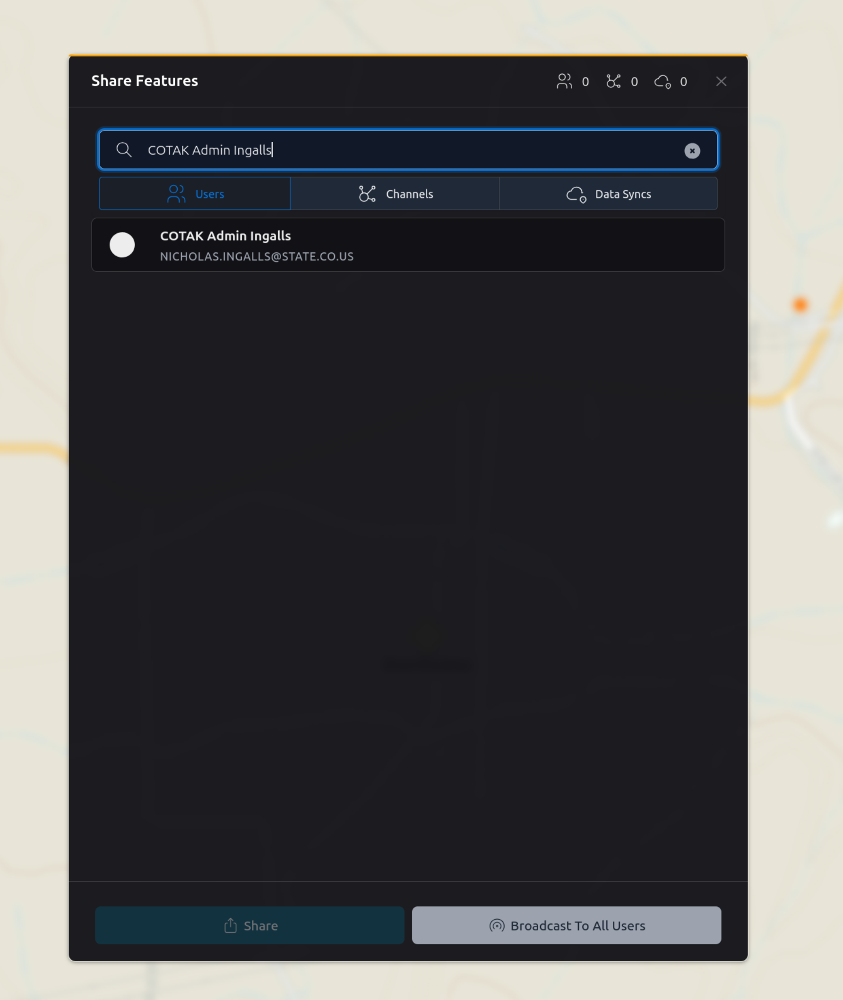

</Steps>

### Navigating to a Feature

<Steps>

1. Click **Navigate** in a feature's details pane, or in the Query Mode panel for any spot on the map.

2. A navigation banner at the top of the map shows the distance to the destination, your speed and ETA (speed and ETA need a live GPS location while moving). Use the zoom button to fit the destination on screen, and the **X** to end navigation. When navigating a route, a **Reverse Direction** button also appears.

    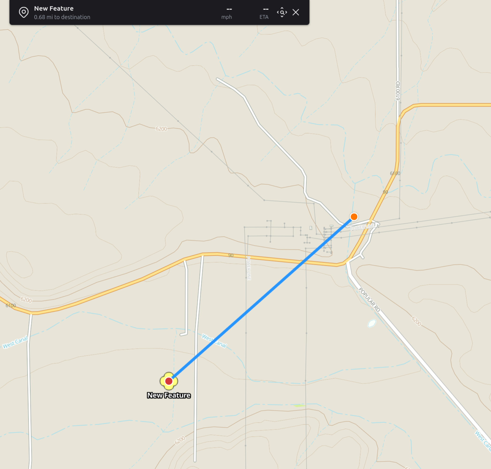

</Steps>

## Menu

 Click the three lines (hamburger) at the top right of the page to view the menu.

### Your Features

All features created by you or shared to you by other users can be viewed here. Click on a feature to snap to it on the map. All features are editable. You can easily delete features or recover recently deleted features.

### Overlays

Allows you to toggle layers on or off of your basemap. Click the eye icon to turn overlays on or off. Click the plus button in the top right corner to add additional pre-existing overlays such as NOAA radar, cell coverage maps, and county boundaries. See information on adding custom overlays under Imports.

### Contacts

Shows a list of all contacts that are online and those who recently closed their TAK application or lost connection with the TAK server. You may search for specific contacts in the filter search bar. Clicking on an online contact will reposition your map to their location. Clicking the chat bubble next to their name will open a chat with that contact.

### Base Maps

Allows you to change the current basemap displayed on CloudTAK. Feel free to choose whichever basemap best suits your needs.

### Data Sync (Missions)

Data Sync is a tool that creates a mission, also known as a feed, which is like a folder for custom data sets, and is hosted within the TAK Server. It allows synchronization of data between multiple devices. Any data in the feed is synchronized to all TAK app users who have subscribed to that feed. This sync happens immediately if the users are connected to the TAK Server, or as soon as a user reconnects to the Server. As a result, data sync is the best method in TAK to ensure that all members of a team receive identical data when planning an operation. Conversely, items deleted by the Data Sync feed creator will disappear from users' maps. This is useful for de-cluttering maps after an incident is complete.

#### Creating a Data Sync

<Steps>

1. Click the plus button in the top right corner.

    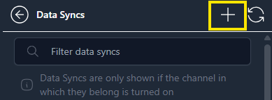

2. Name your Data Sync and select the channel or channels you want it to be available on. Only channels you currently have turned on are displayed as options.

    Advanced Options allows you to password protect your Data Sync and control whether users are:

    - **Owners:** able to subscribe to, edit, and delete the Data Sync
    - **Subscribers** (default): able to subscribe to and edit the Data Sync
    - **Viewers:** able to subscribe to the Data Sync but not make any edits

    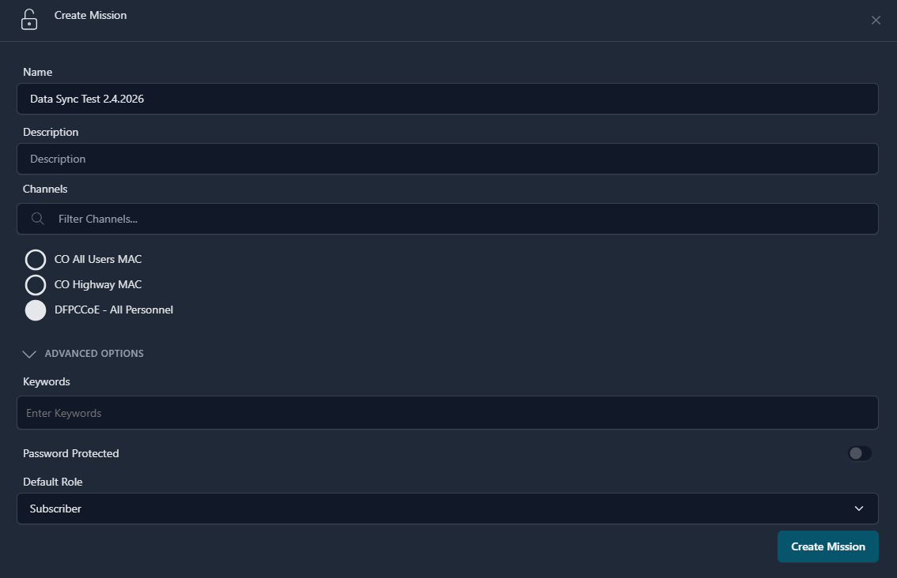

3. Click **Make Active**.

    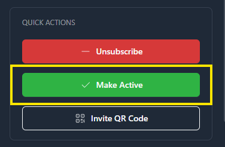

4. The active mission is displayed in the top left corner. While the Data Sync is active, any features you create in CloudTAK are automatically added to it.

    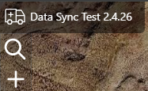

5. To add existing features, select them with the Lasso Tool (see [Drawing Tools](#drawing-tools)), click the three dots, and select **Move to Data Sync**.

    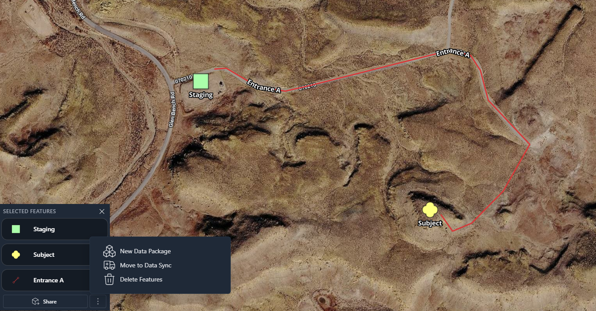

</Steps>

#### The Data Sync Menu

Any Data Sync you are subscribed to has a menu, displayed on the right side. A shortcut to this menu also appears in the top left next to your active mission.

 **Layers:** Displays all features added to this Data Sync.

 **Files:** Displays all files added to the Data Sync.

 **Chats:** Chat for all users subscribed to the Data Sync.

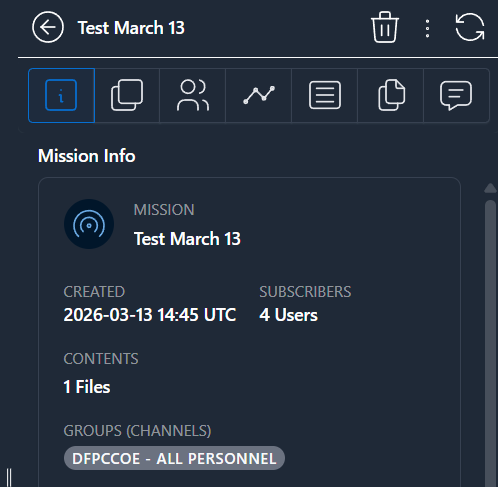
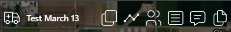

 **Users:** Displays all users subscribed to this Data Sync. Click the plus button to send users a request to join the Data Sync.

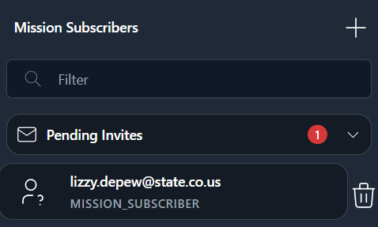

 **Changes:** Displays a log of all added and deleted features, including the date and time the change was made.

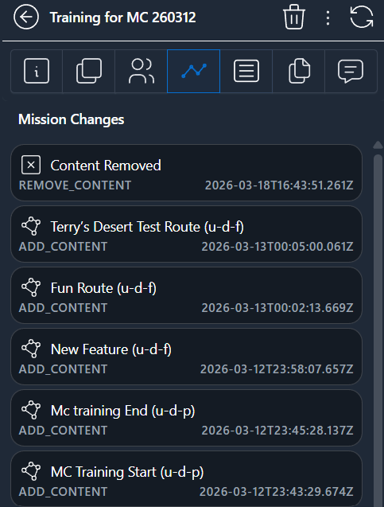

 **Logs:** Allows for documentation of the mission. Logs can be downloaded as a .csv by clicking **Save Log**.

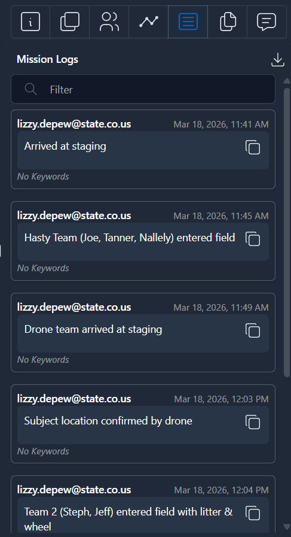

#### Subscribing to an existing Data Sync

<Steps>

1. Make sure you have the channel associated with the Data Sync turned on. Select the Data Sync, then select **Subscribe**. All features in the Data Sync will now appear live on your map.

    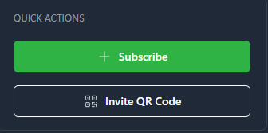

2. To add features to this Data Sync, click **Make Active**. While the Data Sync is active, any features you create in CloudTAK are automatically added to it. After clicking **Deactivate**, features you create are no longer added, but the Data Sync will continue to update.

    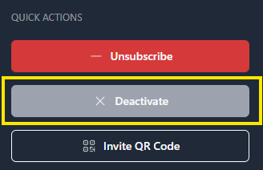

3. To unsubscribe and remove the Data Sync features from your map, click **Unsubscribe**. Some Data Syncs (such as the CDOT cameras) do not allow the **Make Active** option.

    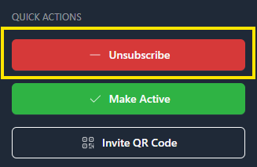

</Steps>

### Data Packages

A tool to bundle items you might want to share with other TAK users.

#### Creating a Data Package

<Steps>

1. Use the Lasso Tool (see [Drawing Tools](#drawing-tools)) to select existing features on your map. A menu will appear displaying the captured features.

    

2. Click the three dots, then **New Data Package**.

    You can also use the plus button on the right side under Data Packages to create a new package.

    

3. Name your Data Package and select the channel or channels you want this data to be available on. Only channels you currently have turned on are displayed as options. If desired, you can add a file to your data package.

</Steps>

:::note
Data Packages are cleared from the server every two months. To keep a Data Package available on your channel indefinitely, add `#permanent` under "Hashtags".
:::

#### Importing an existing Data Package

<Steps>

1. Ensure the correct channel is on, then select the Data Package and click **Import Package**. This imports all features in the data package.

    

2. If the data package has a file such as a KMZ attached, select the file under **Import Results**. This adds the file to your overlays.

    

</Steps>

## Channels

Displays all channels available to your account.

 An open eyeball icon indicates that the channel is currently on and is sharing your location with all other users on that same channel.

 Toggling this icon to the off position (eyeball with slash through it) removes your location and presence from that channel.

To the right of the channels you will also see a pointer arrow icon.

 An arrow icon indicates that users who are active on this channel can see each other.

 An arrow with a slash indicates that users on this channel cannot see each other. Instead, these channels are used to supply you with additional data such as aircraft locations or wildland fire data.

Each user sees a unique list of channels. Some of these channels were created by your agency administrator and are only available to members of your public safety organization, while other channels are available to multiple agencies for use in mutual aid. It is best practice to only turn on mutual aid channels when a need for them arises, but refer to your own agency's policies for definitive guidance.

### Videos

Use the left tab (Streams) to view any video feeds that are currently available. If you get a Video Server Error, the video is either not currently being broadcast or not in a format that is supported by CloudTAK. Use the right tab (Leases) to set up a video lease to broadcast your video stream from a UAS or other source to TAK. This will allow you to broadcast your video stream live to other TAK users on your channel. For more information on how to set up video leases for a UAS see the following videos:

- [UAS Tool Pt 1: Downloading and Operating UAS Tool](https://cotak.gov/pages/tak-integrations/uas-tool-pt1-downloading-and-operating-uas-tool)
- [UAS Tool Pt 2: Streaming CloudTAK Leases](https://cotak.gov/pages/tak-integrations/uas-tool-pt-2-fmv-streaming-cloudtak-leases)

### Chat

Displays all of your current chats. To start a new chat, click the plus button in the top right corner.

### Routes

<Steps>

1. Routes lets you create and save routes from one address to another. Either freehand the route with **No Snapping**, or select **Roads & Trails** to snap to routes.

    

2. Click once to start the route and twice to finish. The route can then be edited and shared like any other feature.

    

</Steps>

### Uploaded Files

All files uploaded through Imports are displayed here. Click on an uploaded file to view its options.

- **Add to Map as Overlay** makes the file appear on the map and in your Overlays tool, where it can be toggled on or off using the eyeball.
- You can also download the file, add it to an existing Data Sync or Data Package, and rename or delete the file.

### Imports

Displays all imported files. To import a new file, select the New Import icon  in the top right to upload files from your desktop.

### Settings

Allows you to change your callsign, device preferences, and preferred settings such as unit type.
