import { Steps, Tabs, TabItem } from '@astrojs/starlight/components';

## First Login

You can use CloudTAK in a web browser on a computer, or in the CloudTAK app on a phone or tablet.

Prefer to watch? [Getting Started with CloudTAK Mobile](https://vimeo.com/1240956751) (11 minutes) walks you through downloading the app, logging in and finding your way around the map.

### Get the CloudTAK App

Skip this section if you are using CloudTAK in a web browser.

<Tabs syncKey="platform">
  <TabItem label="iPhone and iPad" icon="apple">
    Get [CloudTAK on the App Store](https://apps.apple.com/us/app/cloudtak/id6773467848), or scan this code with your iPhone or iPad camera.

    
  </TabItem>
  <TabItem label="Android" icon="mobile-android">
    Get [CloudTAK on Google Play](https://play.google.com/store/apps/details?id=io.cloudtak.app), or scan this code with your Android phone or tablet camera.

    
  </TabItem>
</Tabs>

### Connect and Log In

<Steps>

1. Open CloudTAK and connect to your agency's server.

    - **In a web browser:** go to your agency's CloudTAK address. Your administrator can give it to you.
    - **In the CloudTAK app:** the first time you open the app, the **Connect to Server** screen appears. Choose your agency from **Known Providers**, or select **Manual Entry** and type the server address your administrator gave you.

    

2. Log in with your agency credentials.

    

</Steps>

**Changing servers in the app:** log out, select the gear icon in the bottom right corner of the login screen, then select **Switch Servers**.

### Set Up Your Profile

The first time you log in, the **Welcome to CloudTAK** window asks who you are. You can change these later in Settings.

- **Callsign:** the name other users see for you on the map. We recommend this convention: `[Agency Acronym] [Last Name] [Radio Callsign]`.
- **Team:** sets the color of your marker on the map. Choose the color for your agency type, shown in the chart below.
- **Role:** when in doubt, choose **Team Member**.
- **Phone Number:** optional. It is shared with other users on your channels.

Select **Get Started** when you are done.

### Allow Location and Notifications

After you set up your profile, the **Permissions** window asks to use your **Location** and send you **Notifications**. The steps are different on each device, so select yours below. To set these up later, select **Skip for now** and turn them on in Settings.

<Tabs syncKey="platform">
<TabItem label="Web Browser" icon="laptop">

<Steps>

1. Select **Request Permission** under **Location**.

2. Read how CloudTAK uses your location, then select **Agree and continue**.

3. When your browser asks to know your location, select **Allow while visiting the site**. Some browsers just show **Allow**.

    

4. Select **Request Permission** under **Notifications**. When your browser asks to show notifications, select **Allow**.

    

5. When both show **Allowed**, select **Done**.

</Steps>

</TabItem>
<TabItem label="iPhone and iPad" icon="apple">

<Steps>

1. Select **Request Permission** under **Location**.

2. Read how CloudTAK uses your location, then select **Agree and continue**.

3. Leave **Precise** on and select **Allow While Using App**.

    

4. On the **Background location** screen, select **Agree and continue**.

5. Select **Change to Always Allow** so your team can still see you while CloudTAK is in the background.

    

6. Select **Request Permission** under **Notifications**, then select **Allow**.

7. When both show **Allowed**, select **Done**.

</Steps>

</TabItem>
<TabItem label="Android" icon="mobile-android">

<Steps>

1. Select **Request Permission** under **Location**.

2. Read how CloudTAK uses your location, then select **Agree and continue**.

3. Select **Precise**, then select **While using the app**.

    

4. On the **Background location** screen, select **Agree and continue**.

5. In the settings page that opens, select **Allow all the time** so your team can still see you while CloudTAK is in the background. Scroll down and make sure **Use precise location** is on, then go back to CloudTAK.

    

6. Select **Request Permission** under **Notifications**, then select **Allow**.

7. When both show **Allowed**, select **Done**.

</Steps>
</TabItem>
</Tabs>

### Check Your Location

Once you are on the map, check that your location is right. Phones and tablets with cellular service find it with GPS. On a computer, your location may be missing or only approximate. To see how accurate it is or to set it by hand, see [Location & Coordinates](#location--coordinates).

### Stop Sharing Your Location

CloudTAK shares your location for as long as it's open. On a phone or tablet it keeps sharing in the background, so switching to another app doesn't stop it. To stop, close CloudTAK completely.

<Tabs syncKey="platform">

<TabItem label="Web Browser" icon="laptop">

Close the CloudTAK tab or the browser window.

</TabItem>

<TabItem label="iPhone and iPad" icon="apple">

Swipe up from the bottom of the screen and pause to open the app switcher, then swipe CloudTAK up and off the screen.

</TabItem>

<TabItem label="Android" icon="mobile-android">

Open your recent apps, by swiping up from the bottom of the screen and holding or by selecting the square button, then swipe CloudTAK away.

</TabItem>

</Tabs>

To keep using CloudTAK but stop sharing your location on a particular channel, turn that channel off instead. See [Channels](#channels).

Once you're set up, see [The Map Screen](#the-map-screen) to learn your way around.

## The Map Screen

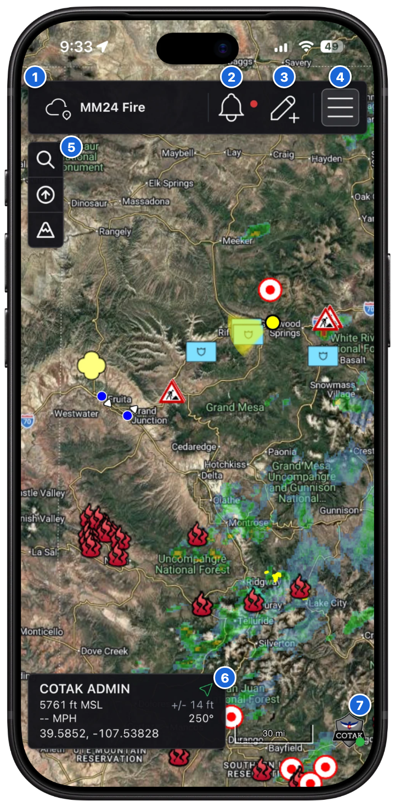

1. **Active mission:** the Data Sync that new features are added to. Shows **No Active Mission** when there isn't one, and selecting it opens your Data Syncs. See [Data Sync](#data-sync).
2. **Notifications:** see [Notifications](#notifications) below.
3. **Drawing Tools:** see [Drawing Tools](#drawing-tools).
4. **Menu:** see [The Menu](#the-menu) below.
5. **Map controls:** see [Map Controls](#map-controls) below.
6. **GPS panel:** your callsign, location and coordinates. See [Location & Coordinates](#location--coordinates).
7. **Server connection:** your server's logo, with a green dot when you're connected and a red dot when you're not. Select it to return the map to its starting view.

On a computer the layout is the same, with a few extras: the active mission has buttons that open its tabs, the zoom buttons are always shown, and an icon bar on the right side of the map has shortcuts to the menu items.

### Notifications

When you have notifications, such as chats, contacts, imports and Data Sync updates, a red badge on the bell at the top right shows how many. Select the bell to see them. Select a notification to go to it, filter them by type, or delete them one at a time or all at once.

### Map Controls

The buttons down the left side of the map are:

- **Search:** see [Searching the Map](#searching-the-map) below.
- **Snap to North:** turn the map back to north up. When the map is following your heading, this is **Orient North** instead.
- **Snap Flat:** only shown when the map is tilted. Flattens it again.
- **Zoom in**.
- **Zoom out**.
- **3D Terrain:** only shown when your server has terrain. Turns 3D terrain on or off.
- **Unlock:** only shown when the map is locked onto a feature with **Lock On**. Select it to stop following the feature.

### Moving Around the Map

Use a mouse on a computer, or touch gestures on a phone or tablet.

| | Mouse | Touchscreen |
| --- | --- | --- |
| Move the map | Click and drag | Drag with one finger |
| Zoom in and out | Scroll the mouse wheel, or use the plus and minus buttons on the left side of the map | Pinch with two fingers |
| Rotate | Hold Ctrl, then drag left or right | Twist two fingers |
| Tilt | Hold Ctrl, then drag up or down | Drag two fingers up or down |

On a phone, the plus and minus zoom buttons are hidden to save space. To show them, open **Settings**, then **Display Preferences**, and set **Display Zoom Controls** to **Always**.

### Searching the Map

 To find a place, select the search button on the left side of the map. On a computer you can also press Ctrl+F (⌘+F on a Mac). Search for an address the way you would in a navigation app, or for coordinates, overlays or another user's callsign. Select a result and the map moves to that location.

### The Menu

 Click the three lines (hamburger) at the top right of the map to open the menu.

- **Search** at the top finds a menu item by name.
- **Tile View** and **List View** switch how the menu items are laid out. The button next to the title shows the view it switches to.
- **Reorder Items** lets you drag items into the order you want. While reordering, select the eye next to an item to choose where it shows:
    - In the menu, and in the icon bar along the edge of the map on a computer.
    - In the menu only.
    - Not at all.
- **Save Order** keeps the new order when you're done.

On a computer, the icon bar along the right side of the map has shortcuts to the menu items while the menu is closed. Items marked **A** are only shown to administrators.

The menu items are covered in these sections:

- [Communication](#communication): Channels, Contacts, Chats and Videos
- [Layers & Files](#layers--files): Features, Overlays, BaseMaps, Iconsets, Routes, History, Files and Data Packages
- [Data Sync](#data-sync)
- [Settings](#settings)

## Location & Coordinates

Everything about your own location is in the GPS panel in the bottom left corner of the map.

### Callsign

Your callsign is at the top of the panel. Select it at any time to move the map back to your location.

### Location Icon

The icon next to your callsign shows where your location comes from:

-  **Live GPS, green:** accurate to within 50 m (about 165 feet).
-  **Live GPS, yellow:** accurate to within 200 m (about 650 feet).
-  **Live GPS, red:** more than 200 m off.
-  **Manual location:** a position you placed on the map yourself.
-  **No location:** CloudTAK doesn't know where you are and you will not appear to other users. This icon also shows briefly while your device finds your location.

The icon is also the button for setting your location by hand.

### Set Your Location

If your location is missing or wrong, set it by hand:

<Steps>

1. Select the location icon  in the top right corner of the GPS panel.

2. A prompt at the bottom of the map says **Click on the map to set your location**. Select your location on the map.

    

</Steps>

The icon changes to a pin to show that you set your location by hand. To go back to your device's GPS, select the icon again, then select **Use GPS**. To close the prompt without changing anything, select the **X**.

### Altitude, Accuracy, Speed and Heading

The middle of the panel shows:

- **Altitude:** your height above mean sea level (MSL).
- **Accuracy:** the `+/-` value, how far off your location may be. Phones use GPS and are usually accurate to within about 30 feet. Computers often don't have GPS, so the browser may estimate your location and it can be much less accurate.
- **Speed:** how fast you are moving. Altitude and speed only show while your location comes from live GPS.
- **Heading:** the direction you are facing, from your device's compass when it has one, or the direction you are moving.

To change the units, open **Settings**, then **Display Preferences**, and set **Distance Unit**, **Elevation Unit** and **Speed Unit**.

### Coordinates

The bottom of the panel shows your coordinates. Click them to open the coordinate menu:

- **Cursor / GPS** (web only): switch between the position of your mouse cursor and your own location. This switch doesn't appear in the mobile apps, which always show your own location.
- **Copy**: copy the coordinates in the current format, ready to paste into a radio log, CAD or chat.
- **Format**: pick DD, DM, DMS, MGRS or UTM. Your choice is saved to your profile.

Coordinate format examples

| Format | Example |
| ------ | ------- |
| DD | `39.7392, -104.9903` |
| DM | `39° 44.3519', -104° 59.418'` |
| DMS | `39° 44' 21.11", -104° 59' 25.08"` |
| MGRS | `13S ED 00831 98811` |
| UTM | `13S 500831 4398811` |

## Drawing Tools

Use the drawing tools to put points, lines, shapes and photos on the map.

Select the pencil icon  in the top right corner to open the menu, then select a tool. To find a tool quickly, select the search icon and type its name.

While you draw, a bar at the bottom of the map shows the tool you're using. Select the check mark to finish, or the **X** to cancel. When you finish, the new feature's details pane opens so you can name and style it.

Drawing works a little differently with a finger than with a mouse, because the map can't see your finger until it touches the screen. Each tool below says what to do on a computer and on a phone or tablet. On a phone, tools with their own pane, such as Coordinate Input and Range Rings, open it as a full-screen window instead.

### Coordinate Input

Place a point at coordinates you type in. Enter a name and the coordinates in any format (DD, DM, DMS, MGRS or UTM), choose the point type, then select **Create Point**.

### Create Event

Start a shared record of an incident, such as a wildfire or a search, that your team can work from together.

An event is more than a marker. It's kept on the CloudTAK server and shared with the channels you choose, so everyone on those channels sees it on their map, including people using other TAK apps. Each event keeps track of its own priority, start and end times, the people assigned to it, and any linked missions, links and forms, so it can be the one place everyone checks during an incident.

**Events are in beta**, so how they work may change between releases.

<Steps>

1. Select **Create Event** from the Drawing Tools menu. You can also select **Create Event** at the top of the Query Mode panel to start one at a spot on the map, with its address filled in. See [Working with Map Features](#working-with-map-features).

2. Fill in the event:

    - **Name** (required): what the event is called, such as "Grass Fire".
    - **Priority:** **none**, **low**, **medium**, **high** or **critical**.
    - **Type:** the symbol the event shows on the map. It starts as a friendly **Incident**. See the next step to change it.
    - **Coordinates:** where the event is. This starts at the center of the map, and you can type coordinates in any format.
    - **Location:** an address or place name.
    - **Remarks:** any notes, with bold, lists and links if you need them.
    - **Share to Channels** (required): choose at least one channel. Only channels you have turned on are listed.

    

3. To change the type, select **Type**. This is the same symbol picker as on a marker's details:

    - **Affiliation:** the menu next to **Filter**. Choose **Friendly**, **Hostile**, **Neutral**, **Unknown** or another affiliation. The symbol's frame and color change to match.
    - **Status:** **Present**, **Planned**, **Fully Capable**, **Damaged**, **Destroyed** or **Full to Capacity**.
    - **Symbol:** type in **Filter** to search every symbol, or browse the symbol sets and select one.

    

    If your administrator has set up event types, you choose one of those instead, or **Other** to use the picker.

4. Select **Create Event**. The button stays greyed out until the event has a name and at least one channel.

</Steps>

The new event opens in its own pane. From there you can:

- **End** the event when it's over, or **Reactivate** it later.
- Move its marker, zoom to it, or delete it.
- Choose whether other people can edit it.
- Add the people managing it under **Assignments**, each with a role such as Incident Commander.
- Link it to Data Sync missions, add links, and fill out forms under **Forms**.

You'll find every event you can see under **Menu** → **Features** → **Events**.

### Quick Pic

Take a photo and drop a marker with the photo attached at your current location, or at the center of the map if CloudTAK doesn't know where you are. Select **Take Photo**. On a phone or tablet this opens the camera.

### Range & Bearing

Draw a line from a starting point at a bearing and distance you choose. Enter a name, the starting coordinates in decimal degrees, the bearing and the distance, then select **Create Range & Bearing**.

### Range Rings

Draw rings at set distances around a point. Useful for evacuations, searches and manhunts. Enter a name and the origin, set the diameter of each ring (select **Add Ring** for more), and choose the color, opacity and line width.

### Draw Point

Choose the point type in the bar at the bottom of the map (Custom Point, Unknown, Friendly, Hostile or Neutral), then click the map to drop the point, or tap it on a phone or tablet.

### Draw Line

- **Computer:** click the map to add each point along the line. To finish, click the last point again, press **Enter**, or select the check mark.
- **Phone or tablet:** tap to add each point. The line doesn't follow your finger between taps, so each section appears when you tap. To finish, tap the last point again or select the check mark.

To follow roads and trails instead of drawing straight sections, choose a snapping layer from the menu in the bar at the bottom of the map. It starts as **No Snapping**, and the layers you can choose depend on your server. On a phone, the menu is under **More**.

With a trail layer chosen, the line follows the trail between the points you add, switchbacks and all:

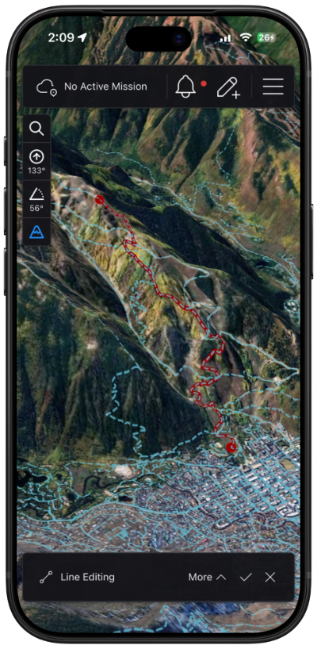

### Draw Polygon

Draw any shape with three or more corners.

- **Computer:** click the map to add each corner. To close the shape, click the first corner again, press **Enter**, or select the check mark.
- **Phone or tablet:** tap to add each corner, then tap the first corner again or select the check mark.

### Draw Rectangle

Draw a rectangle at any angle.

- **Computer:** click two corners to set the length and angle of one side. Move the pointer to either side to set the width, then click a third time.
- **Phone or tablet:** tap two corners for one side, then tap where the opposite side should be. The rectangle appears when you tap, rather than following your finger.

### Draw Circle

- **Computer:** click the center, move the pointer out to the size you want, and click again. You can also press at the center and drag out.
- **Phone or tablet:** press and hold the center of the circle, drag your finger out to the size you want, then lift your finger.

### Draw Sector

Draw a wedge, such as a search area or a camera's field of view.

- **Computer:** click the center. Click again to set how far the wedge reaches and where one side starts, then move the pointer around to sweep the wedge open and click a third time to set the other side.
- **Phone or tablet:** tap the center, tap where one side of the wedge should end, then tap where the other side should be.

### Lasso Select

Select several features at once. First choose where to select from in the bar at the bottom of the map: **Map Features**, or one of your overlays. On a phone, this is under **More**.

- **Computer:** click to start the loop, move the pointer around the features you want, and click again to finish. You can also press and drag.
- **Phone or tablet:** press and drag your finger around the features you want, then lift your finger to finish.

When you finish, the features inside the loop are listed in a **Selected Features** menu in the bottom left corner of the map. From there you can:

- **Share** the features with other users.
- Select the three dots for more options: **New Data Package**, **Move to Data Sync**, or **Delete Features**.
- Select the trash can next to a feature to take it out of the selection. This doesn't delete it from the map.

**Delete Features** takes every selected feature off your map. Features that only exist on your map, like the ones you've drawn, are gone for good. Features that are syncing to your map from somewhere else, like another user's icon or an aircraft, come back the next time they update.
- Select the **X** to close the menu and clear the selection.

### GeoJSON Import

Add a small GeoJSON file (.json or .geojson) to the map. After you choose the file, CloudTAK lists the features it found. Select **Create Features** to add them. They show up in **Your Features** and can each be edited, but they are features on your map rather than an overlay, so you can't toggle them on or off. Upload large files through **Imports** instead.

### Editing What You've Drawn

To move, edit, delete or share anything you've drawn, select it on the map. See [Working with Map Features](#working-with-map-features).

## Working with Map Features

Everything on the map, from other users and aircraft to markers, shapes and overlay data, can be selected for more information. When several features overlap where you click, a list appears so you can pick the right one. Hold **Ctrl** while clicking to add a feature to a multi-selection.

### The Feature Radial Menu

Click a feature, or tap it on a phone or tablet, to open its radial menu.

Not every feature has every option. For example, other users have no **Edit**, and overlay data usually only has **View**.

- **Edit:** move a point by dragging it, or change the shape of a line or polygon.
- **Delete:** take the feature off your map. Anything syncing to your map from somewhere else, such as another user's position, comes back the next time it updates.
- **Lock On:** points only. The map follows the feature as it moves, which is useful for vehicles, aircraft and GPS trackers.
- **Play:** open the feature's video stream, when it has one.
- **Geometry:** open a second ring with more options, shown below.
- **Cut:** only for features in an ArcGIS FeatureServer overlay. Copy the feature onto your map as your own feature, which you can then edit and share.
- **View:** open the feature's details pane. See [The Details Pane](#the-details-pane).

The **Geometry** ring has:

- **Buffer:** draw a perimeter at a distance you choose around the feature.
- **Copy:** copy the point so you can paste it somewhere else on the map. See [The Map Radial Menu](#the-map-radial-menu). Only points can be pasted for now.
- **Split:** lines only. Split the line in two at the spot you clicked.

Select the center of the ring to go back.

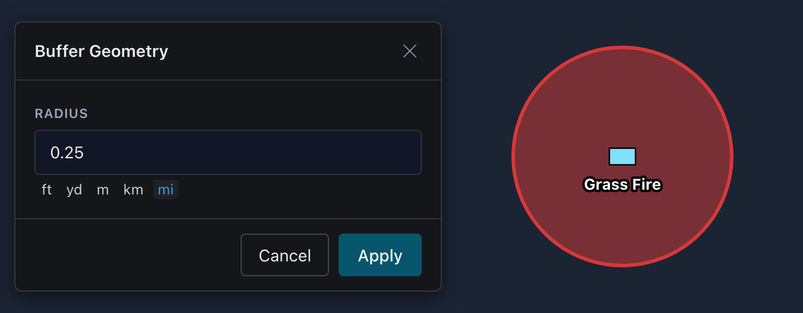

### The Details Pane

Select **View**  in the radial menu to open a feature's details. The name at the top can be changed if you're allowed to edit the feature.

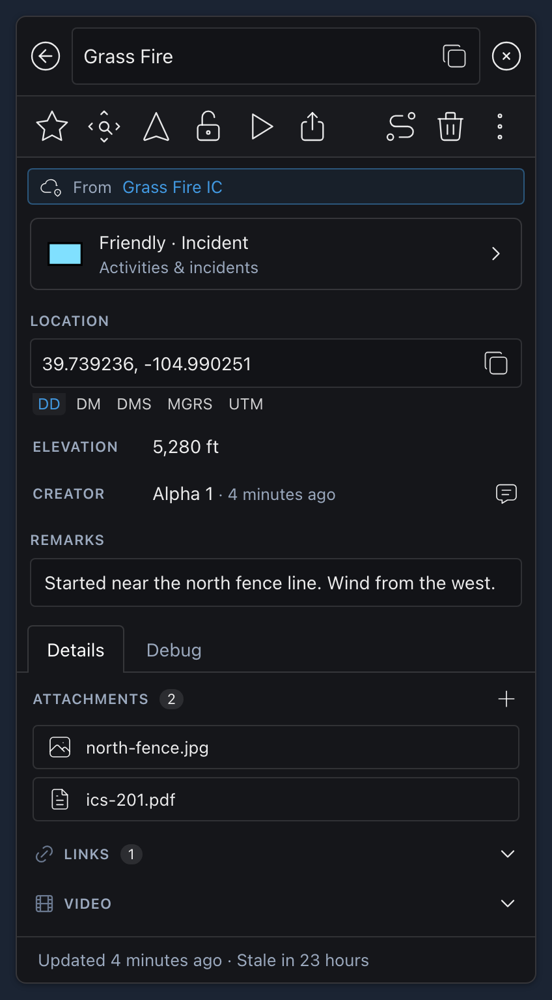

The buttons along the top are:

- **Saved**: the feature is saved on your map, so it doesn't disappear when it stops updating. This yellow star only shows the feature is saved and can't be turned off. Features you draw are saved automatically.
- **Save Feature**: shown instead of the yellow star on features that aren't saved yet. Select it to save the feature. Not shown for people.
- **Zoom To**: center the map on the feature.
- **Navigate**: points and routes only. See [Navigating to a Feature](#navigating-to-a-feature).
- **Lock On**: points only. The map follows the feature as it moves.
- **View Video Stream**: when the feature has video.
- **Share**: see [Sharing Features](#sharing-features).
- **Breadcrumb**: points only. Show a **Live Trail**, or **Load History** for the last 1, 4, 8 or 24 hours.
- **Delete**: when you're allowed to edit the feature.
- **More Actions**: **Edit Geometry**, **Chat** with another user, **Buffer**, and **Convert to Route** for lines. For features you can edit, you can also add an attachment, external links, a video, a sensor field of view, or a geofence (polygons only).

Below the buttons are:

- **From**: the Data Sync the feature belongs to, if any. Select its name to open the Data Sync. A **Read Only** badge means your role in that Data Sync doesn't let you change the feature.
- **Appearance**: the feature's symbol or style. Select it to change how the feature looks. See [Changing a Feature's Appearance](#changing-a-features-appearance).
- **Location**, or **Center** for lines and shapes, which you can change if you're allowed to edit the feature. Then elevation, length, area or radius, speed and course, phone, email, battery and who created it, when they're known.
- An **elevation profile** for lines, when a terrain layer is turned on.
- **Remarks**.

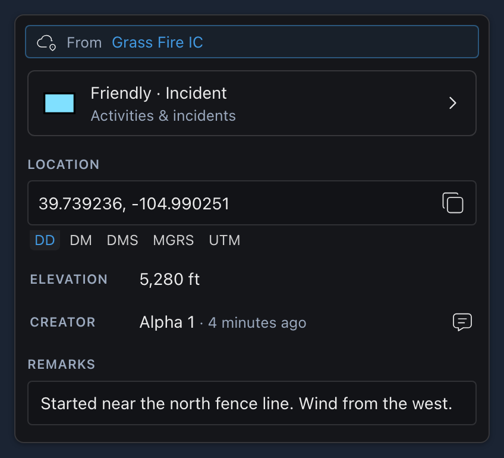

The tabs below that switch between **Details** (attachments, links, video, sensors and other information sent with the feature), **Channels** (people only: which channels they're on) and **Debug** (the underlying data). Unless the feature is saved, the bottom of the pane shows when it was last **Updated** and when it goes **Stale**.

### Changing a Feature's Appearance

Select the **Appearance** row in the details pane to change how a feature looks. Changes show on the map as you make them. You can only change features you're allowed to edit, and some point types, such as photos, don't have an Appearance row.

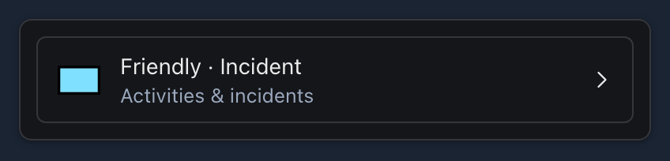

**For a point:**

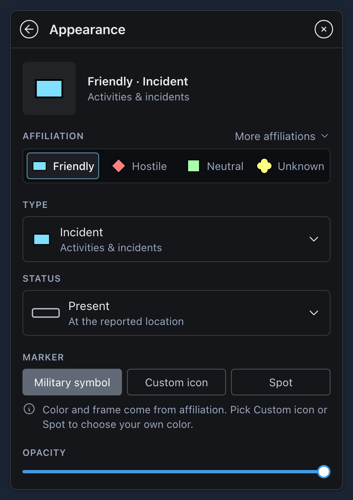

- **Affiliation:** **Friendly**, **Hostile**, **Neutral** or **Unknown**. **More affiliations** has the rest, such as **Assumed friend**, **Suspect** and **Pending**, and for military symbols whether it's real, an exercise or a simulation.
- **Type:** what the feature is. Search all types, or browse them by category, such as **Land units**, **Land equipment** or **Activities & incidents**.
- **Status**, **echelon** and **indicators** such as **Headquarters** and **Task force**: shown for newer (2525E) military symbols only.
- **Marker:** how the point is drawn on the map.
    - **Military symbol:** the color and frame come from the affiliation.
    - **Custom icon:** choose an **Iconset**, find the icon you want with the filter, and pick a color. The type stays the same. CloudTAK has many icon sets, but other TAK apps may not support the specialty ones and often show those icons as a yellow clover instead.

        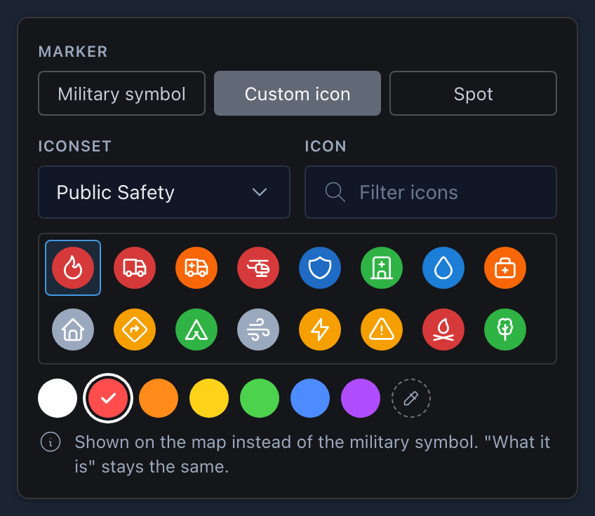

    - **Spot:** a plain dot in the color you choose, with no type.
- **Opacity**.

**For a line or polygon:** choose the **Stroke** color, **Line style** (solid, dashed, dotted or outlined), **Width** and **Stroke opacity**. Polygons also have a **Fill** color and **Fill opacity**.

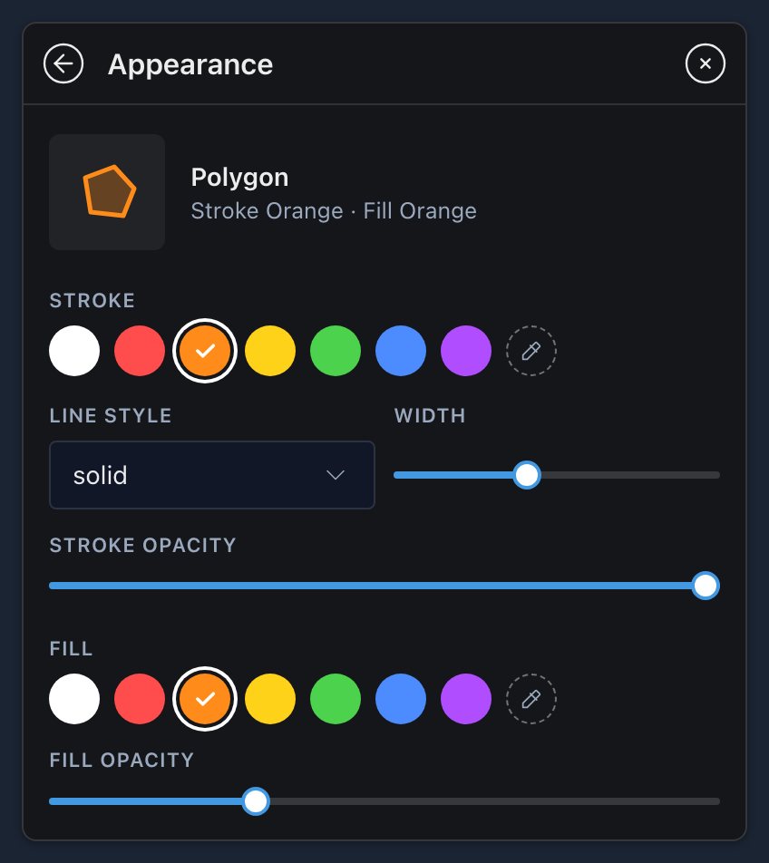

### Sharing Features

<Steps>

1. Open the feature's details pane and click **Share**. You can also share several features at once from a Lasso selection (see [Drawing Tools](#drawing-tools)).

2. In the **Share Features** window, choose who receives it from the **Users**, **Channels** or **Data Syncs** tabs, then click **Share**.

    **Broadcast To All Users** sends the feature to everyone on your active channels instead.

    The **Data Syncs** tab only lists Data Syncs you're subscribed to and allowed to add features to. It doesn't have to be your active mission. To share to one that isn't listed, subscribe to it first. See [Subscribing to a Data Sync](#subscribing-to-a-data-sync).

    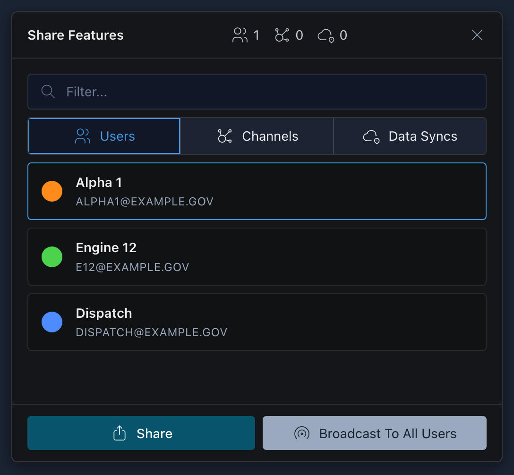

</Steps>

:::caution[Broadcast with care]
**Broadcast To All Users** sends the feature to every user on every channel you have turned on. That can include mutual aid and other channels shared across many agencies. Before you broadcast, check which channels are on (see [Channels](#channels)), or share with specific users or channels instead.
:::

### Navigating to a Feature

<Steps>

1. Click **Navigate**  in a feature's details pane, or in the Query Mode panel for any spot on the map (see [Querying a Point on the Map](#querying-a-point-on-the-map)).

2. A navigation banner at the top of the map shows the distance to the destination, your speed and ETA (speed and ETA need a live GPS location while moving). Use the zoom button to fit the destination on screen, and the **X** to end navigation. When navigating a route, a **Reverse Direction** button also appears.

    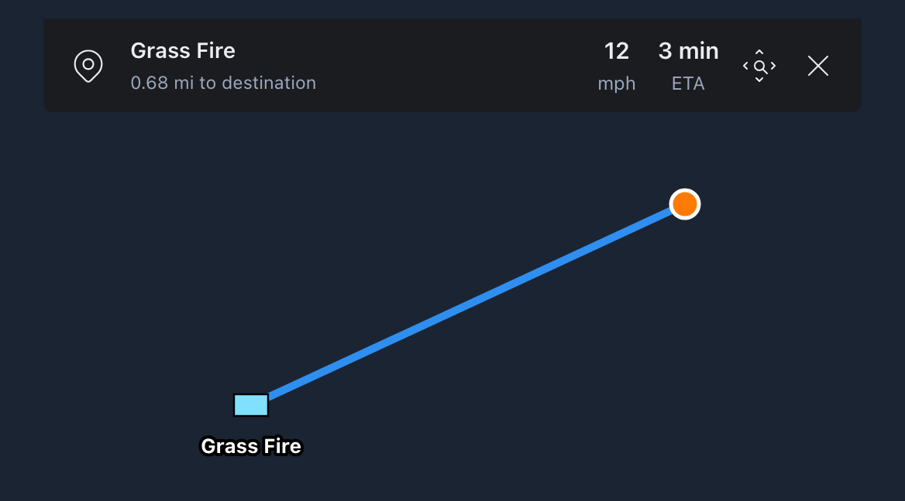

</Steps>

### The Map Radial Menu

Right-click an empty spot of the map, or press and hold on a phone or tablet, to open a different radial menu:

- **New Feature:** drop a point here, using your default point type. To change it, open **Settings**, then **Callsign & Device Preferences**, and set **Default Point Type**.
- **Paste:** paste a point you copied with **Copy** here. Paste is usually shown even when you haven't copied a point, and selecting it then shows an error.
- **Info:** open Query Mode for this spot. See [Querying a Point on the Map](#querying-a-point-on-the-map) below.

### Querying a Point on the Map

Query Mode gives you information about any spot on the map without placing a marker.

<Steps>

1. Right-click an empty spot on the map, or press and hold on a phone or tablet, then select **Info** .

2. The Query Mode panel shows:

    - **Coordinates** of the spot, switchable between formats
    - **Location**: the nearest address or place name
    - **Elevation**, when elevation data is available for the area
    - **Weather** from the National Weather Service: wind, humidity, dewpoint and precipitation. US locations only.
    - **Sun Phase**: sunrise, sunset and twilight times, with the current local time
    - **Magnetic Declination**: the difference between true and magnetic north, needed for compass bearings

    

3. From the buttons at the top of the panel you can **Navigate** to the spot, **Create Route** to it, or **Refresh** the information. [**Create Event**](#create-event) starts a new event at this location, pre-filled with the address.

</Steps>

## Communication

Channels decide who you share your location with and what data you see. Contacts, Chats and Videos are how you reach the people and feeds on those channels. Open the menu and select the item you want.

### Channels

Lists every channel available to your account. Select a channel to turn it on or off.

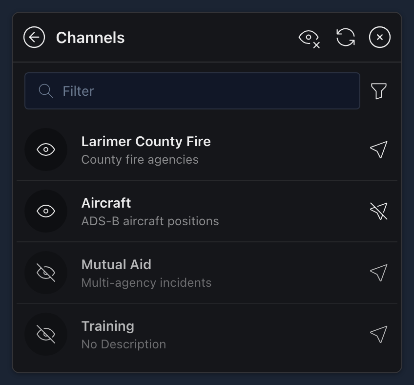

- **On:** you see the channel's data, and share your location on it if it allows location sharing.
- **Off:** the channel's data is hidden and your location isn't shared on it.

The icon on the right shows what kind of channel it is:

- **Location Sharing:** everyone on the channel can see each other.
- **No Location Sharing:** your location isn't shared. These channels supply data instead, such as aircraft positions or wildland fire data.

**All Channels Off** at the top turns every channel off at once. When they're all off, it becomes **All Channels On**.

Each user sees a unique list of channels. Some of these channels were created by your agency administrator and are only available to members of your public safety organization, while other channels are available to multiple agencies for use in mutual aid. It is best practice to only turn on mutual aid channels when a need for them arises, but refer to your own agency's policies for definitive guidance.

### Contacts

Lists the people online on your channels, grouped by team color, with how many are in each team. **Recently Offline** lists people who recently closed their TAK app or lost their connection.

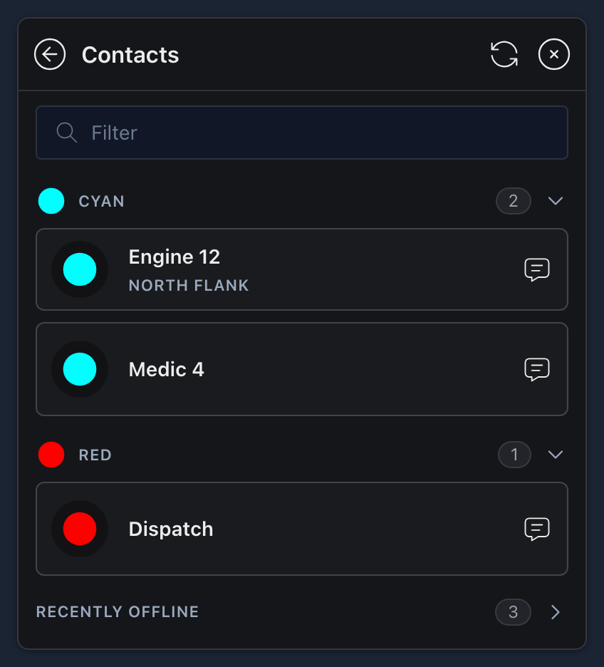

Use the filter to find someone. Select an online contact to go to their location on the map, or select the chat bubble next to their name to chat with them.

### Chats

Lists your chats, with a count of unread messages. Select a chat to open it, type in **Send Message...**, and select send.

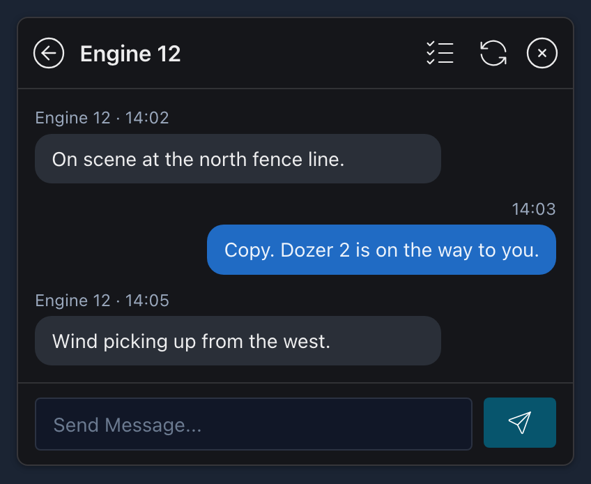

- **New Chat** opens [Contacts](#contacts). Select the chat bubble next to the person you want to message.
- **Select Chats** lets you select several chats to delete them.

Each Data Sync also has its own chat for everyone subscribed. See [The Data Sync Page](#the-data-sync-page).

### Videos

The **Streams** tab lists the video streams set up on your channels. Being listed doesn't mean a stream is live: it only plays while its source is broadcasting. A drone, for example, has to be flying and sending video to an active lease. Select a stream to watch it in a video window you can move around the map. Video from features on the map, such as a camera, is listed too, and selecting one opens its [details pane](#the-details-pane).

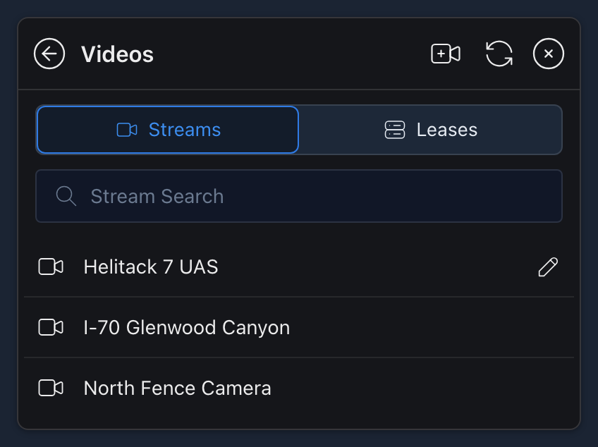

If you get a **Video Server Error**, the video either isn't being broadcast right now or is in a format CloudTAK doesn't support.

The **Leases** tab is for sending your own video, such as from a drone (UAS), to TAK:

<Steps>

1. Select **Get Lease**. Give the lease a **Name**, choose how long it lasts, and set the type of source.

2. Save the lease. It lists the addresses to send your video to. Enter one of them in your drone's or camera's streaming settings.

3. Select play next to the lease to watch the stream. Turn on **Publish to TAK Server** in the lease to list it for other TAK users too.

</Steps>

Leases have more options, such as **Shared Lease** so everyone on your channel can manage it, **Record Stream**, and separate usernames and passwords for watching and publishing. When a lease expires, you can renew it without its address changing.

**Publish Video Stream** adds a video feed that already exists, by its URL, so others on your channels can watch it.

For more on streaming from a drone, see:

- [UAS Tool Pt 1: Downloading and Operating UAS Tool](https://cotak.gov/pages/tak-integrations/uas-tool-pt1-downloading-and-operating-uas-tool)
- [UAS Tool Pt 2: Streaming CloudTAK Leases](https://cotak.gov/pages/tak-integrations/uas-tool-pt-2-fmv-streaming-cloudtak-leases)

## Layers & Files

These menu items control what's loaded on your map: your saved features, overlays, basemaps and icons, and the files you upload. Open the menu and select the item you want.

### Features

Lists the features saved on your map, such as the ones you've drawn and the ones you've saved with the star in their details pane. Select a feature to go to it on the map.

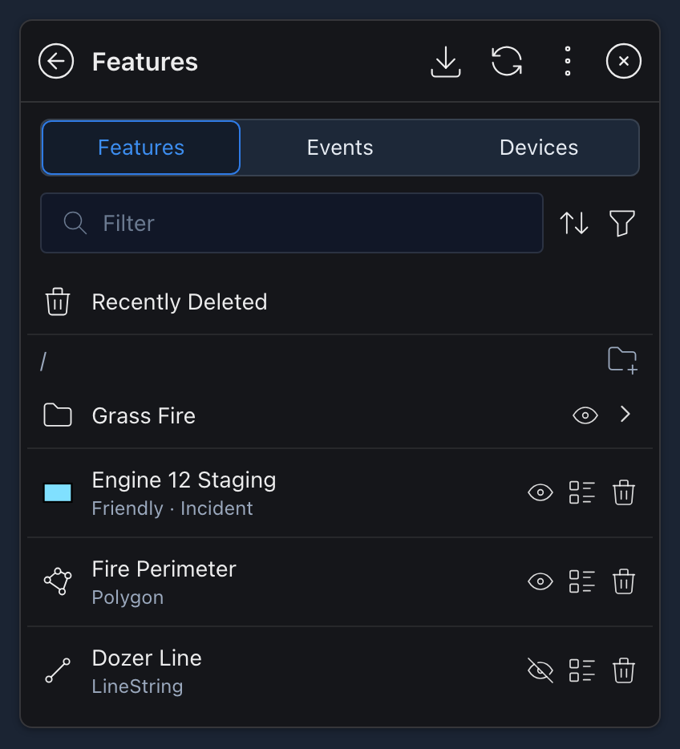

- Next to each feature:
    - The eye shows or hides it on the map.
    - **View Info** opens its [details pane](#the-details-pane).
    - The trash can deletes it.
- **Create Folder** keeps features organized. Drag features into a folder, and use the eye next to the folder to show or hide everything in it.
- **Recently Deleted** lists features you've deleted. Select the ones you want back, then **Restore Features**.
- **Export** saves all your features as a GeoJSON or KML file.
- The filter at the top searches by name and can narrow the list to points, lines or polygons.

The **Events** tab lists the events made with [Create Event](#create-event), and **Create Event** starts a new one. The **Devices** tab lists your agency's tracked devices. Select one to see its details. Both tabs are empty if your agency doesn't use them.

### Overlays

Overlays are layers drawn on top of your basemap, such as weather radar, boundaries, files you've uploaded and your Data Syncs.

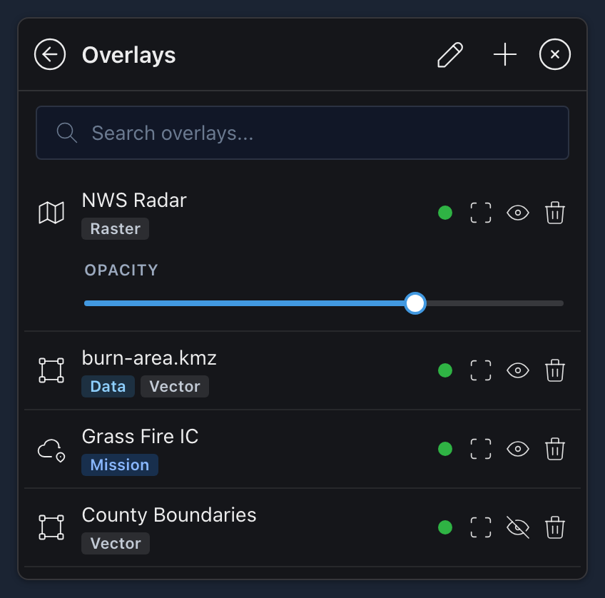

Each overlay is labelled with what it is: **Raster** or **Vector** map layers, **Terrain**, **Mission** for a Data Sync, or **Data** for a file you uploaded. A red **Issue** label means it couldn't load. The buttons next to each overlay are:

- **Zoom To Overlay:** move the map to where the overlay is.
- **Hide Layer** and **Show Layer:** the eye means the overlay is showing, and selecting it hides the overlay. The crossed-out eye means it's hidden, and selecting it shows the overlay again.
- **Delete Overlay:** remove it from your overlays. Not shown for the basemap or CloudTAK's built-in layers.

Select an overlay to see more: an **Opacity** slider for raster layers, or a list of the layers inside a vector overlay. To change which overlay is drawn on top, select the pencil at the top, drag the overlays into order, and select the check mark to save.

#### Adding an Overlay

Select **Add Overlay** to open the **Overlay Explorer**. It has two parts:

- **Your Files** is for your own overlays. It takes you to [Files](#files), where you can upload a file and add it to the map. See [Uploading a File](#uploading-a-file).
- Everything below it is the overlays your server provides, such as weather and boundaries. Browse the folders or search, then select an overlay to add it.

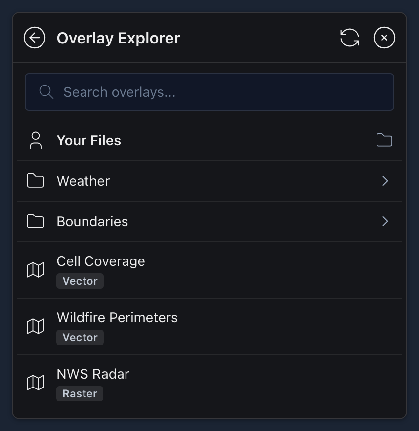

### BaseMaps

The basemap is the map underneath everything else, such as satellite imagery or streets. Select a basemap to switch to it.

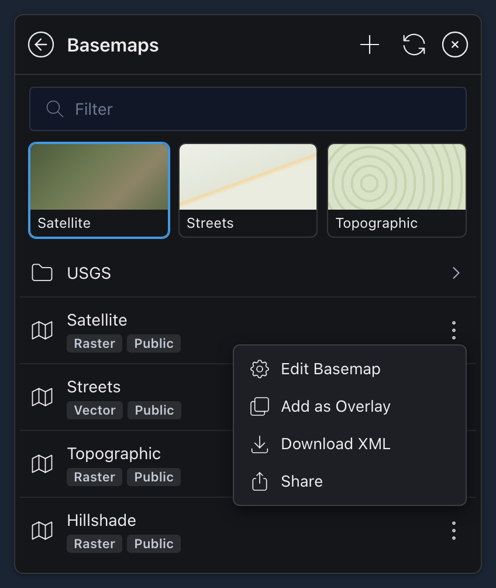

- The pictures at the top are favorites your administrator has picked, for quick switching.
- Folders group more basemaps together.
- Each basemap's three dots have:
    - **Add as Overlay**, to draw it on top of your current basemap instead. See [Overlays](#overlays).
    - **Download XML**, to use the basemap in another TAK app such as ATAK or WinTAK.
    - **Share**, to send it to other users.
    - **Edit Basemap**, for basemaps you created.

**Download XML** and **Share** are only shown when the basemap allows sharing. To add your own basemap, such as from a tile URL or an ArcGIS service, select **Create Basemap**.

### Iconsets

Icon sets are the collections of icons you can pick from when you give a point a **Custom icon**. See [Changing a Feature's Appearance](#changing-a-features-appearance).

- The **Iconsets** tab lists every icon set, and the **Icons** tab lets you browse or search all their icons at once.
- **Zip Upload** adds an icon set from a TAK icon set zip, such as one exported from ATAK. Icon sets also arrive with some imports, such as KMZ files. See [Uploading a File](#uploading-a-file).
- **Create Iconset** starts a new, empty icon set you can add icons to.
- **Download TAK Zip** saves an icon set to use in another TAK app.

### Routes

Lists the routes on your map. To have CloudTAK plan one for you:

<Steps>

1. Select **New Route**.

2. Search for or pick on the map a **Start Location** and an **End Location**, then choose the **Travel Mode**. You can also choose the **Routing Provider** when your server offers one.

3. Select **Generate Route**. The route is added to your map, named after its start and end, and its details pane opens. From there you can navigate it, share it or edit it like any other feature.

    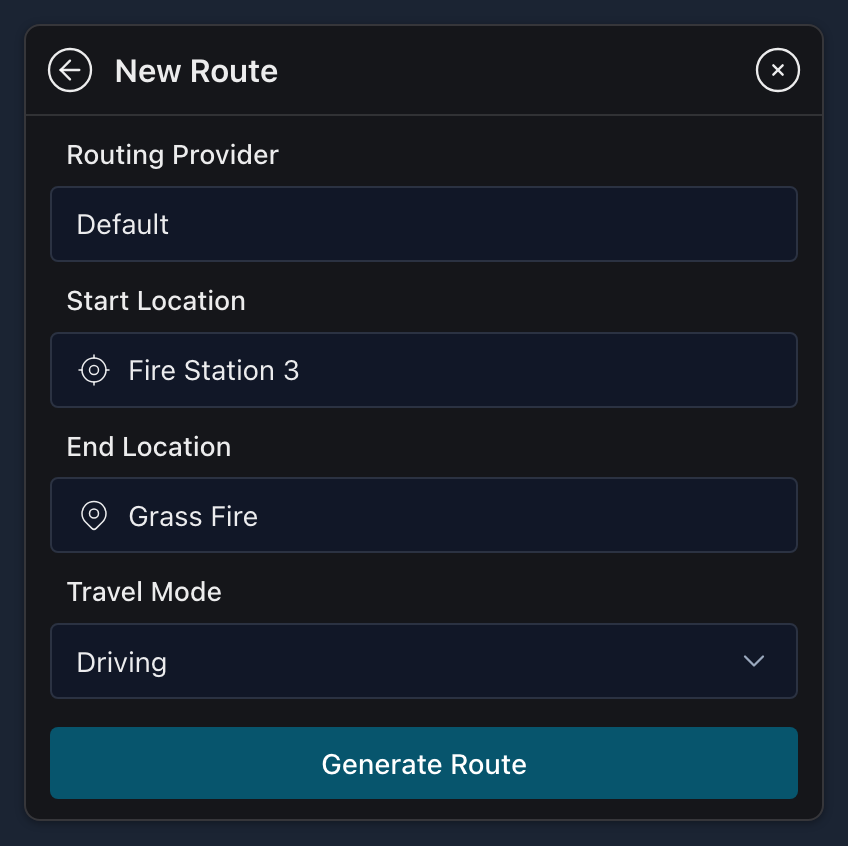

</Steps>

To draw a route yourself, use [Draw Line](#draw-line) and select **Convert to Route** in its details pane.

### History

Lists the breadcrumb trails on your map: the paths people and vehicles have taken.

<Steps>

1. Choose a **Window** of 1, 4, 8 or 24 hours. To only load trails for the area you're looking at, turn on **Current map view only**.

2. Select **Load**. CloudTAK gets every position the TAK Server recorded in that window and makes a trail for each person or vehicle, even ones you never [started a breadcrumb](#the-details-pane) for. Each trail shows who it belongs to, the time it covers and how many points it has.

    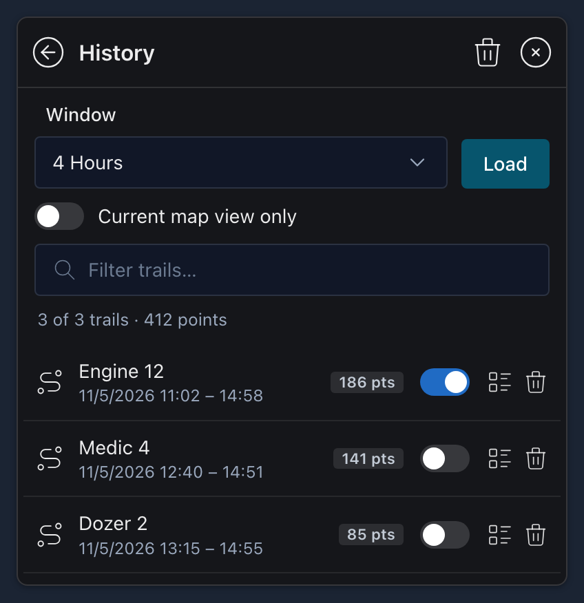

3. Select a trail to go to it on the map. Next to each trail:

    - The switch turns on **Live Trail**, so the trail keeps growing as new positions come in.
    - **View CoT** opens that feature's [details pane](#the-details-pane).
    - **Clear Trail** removes the trail from the map. **Clear All Trails** at the top removes them all.

</Steps>

To show the trail for one feature, you can also select **Breadcrumb** in its [details pane](#the-details-pane), then **Live Trail** or **Load History**.

### Files

The **Online** tab lists the files you've uploaded, and you can organize them into folders. To upload a new one, see [Uploading a File](#uploading-a-file) below. Select a file to see its options:

- **Add to Map as Overlay** puts the file on the map and in your [Overlays](#overlays), where you can turn it on or off with the eye.
- **Download** saves a copy. For map files, it can also **Make Available Offline**.
- **Add to Data Sync**, **Create Data Package** or **Share to Channel** shares the file with others.
- **Rename File**, **Move to Folder** and **Delete File**.

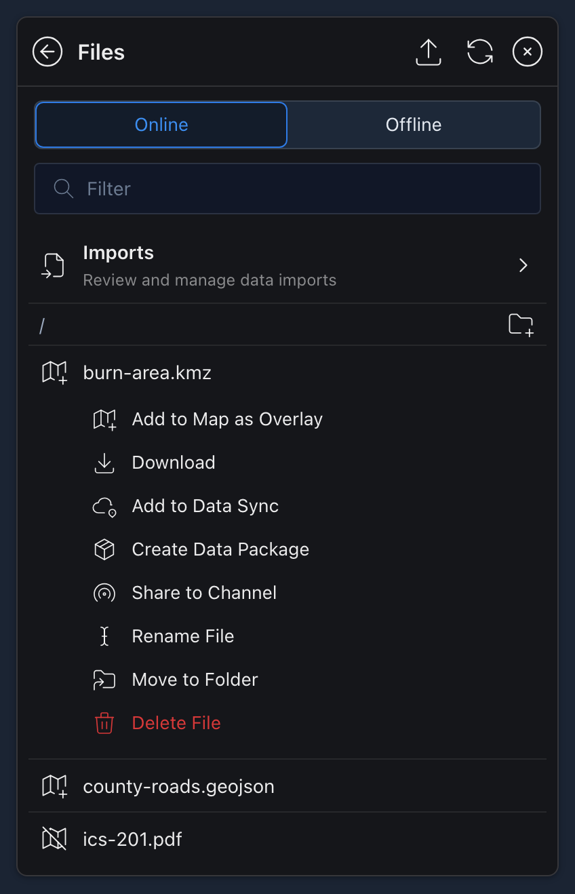

The **Offline** tab lists what's saved on this device for use without a connection.

#### Uploading a File

<Steps>

1. In **Files**, select **File Upload** at the top, then **Upload**, and choose the file. On a computer, you can also drag a file onto the map.

2. The import opens and shows its progress. When it's done, **Import Results** shows where the file ended up. Select a result to go to it:

    - Map files go to your [Files](#files), where you can select **Add to Map as Overlay**.
    - Features from a Data Package go to your [Features](#features).
    - Icon sets go to [Iconsets](#iconsets), and basemap XML files go to [BaseMaps](#basemaps).

</Steps>

To see all your imports and how they went, select **Imports** at the top of the Files list. If an import failed, select **Retry Import** next to it to try again.

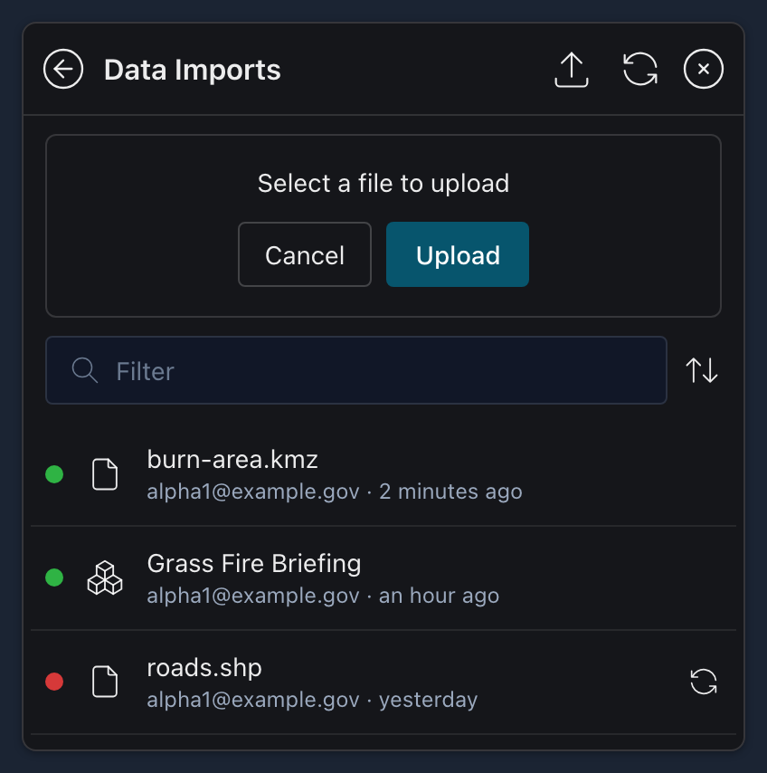

You can upload files up to 5 GB:

- **Map data:** GeoJSON, KML or KMZ, and Shapefiles. A Shapefile must be uploaded as a zip that also has its .dbf, .prj and .shx files.
- **Imagery:** GeoTIFF, MBTiles, and PDFs that are georeferenced (GeoPDF).
- **TAK files:** Data Packages (.zip) and basemap XML files.

### Data Packages

A Data Package bundles features and files so you can share them with other TAK users on a channel.

#### Creating a Data Package

<Steps>

1. Select the features to include with [Lasso Select](#lasso-select), select the three dots, and then **New Data Package**.

    To make a package from a file instead, open the menu, select **Data Package**, and select **Create Package**.

2. In the **Create Data Package** window, give the package a **Name**, check its **Contents**, choose the channels to share it on, and add any hashtags. Only channels you currently have turned on are listed. Select **Create**.

    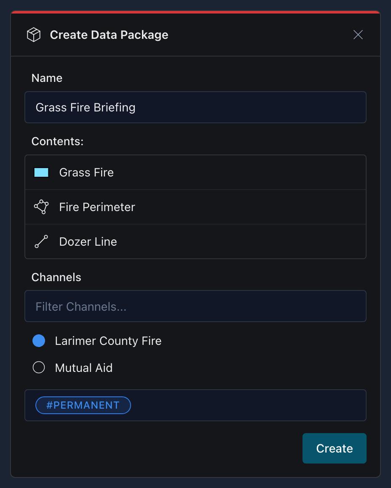

</Steps>

:::note
Data Packages are cleared from the server every two months. To keep a Data Package available on your channel indefinitely, add the hashtag `#permanent`.
:::

#### Importing an Existing Data Package

<Steps>

1. Make sure the channel the package is on is turned on. Open the menu, select **Data Package**, and select the package. Its page shows who created it, its channels, **Expiry**, hashtags and size.

2. Under **Quick Actions**, select **Import Package**. **Share Package** sends it to other users instead.

    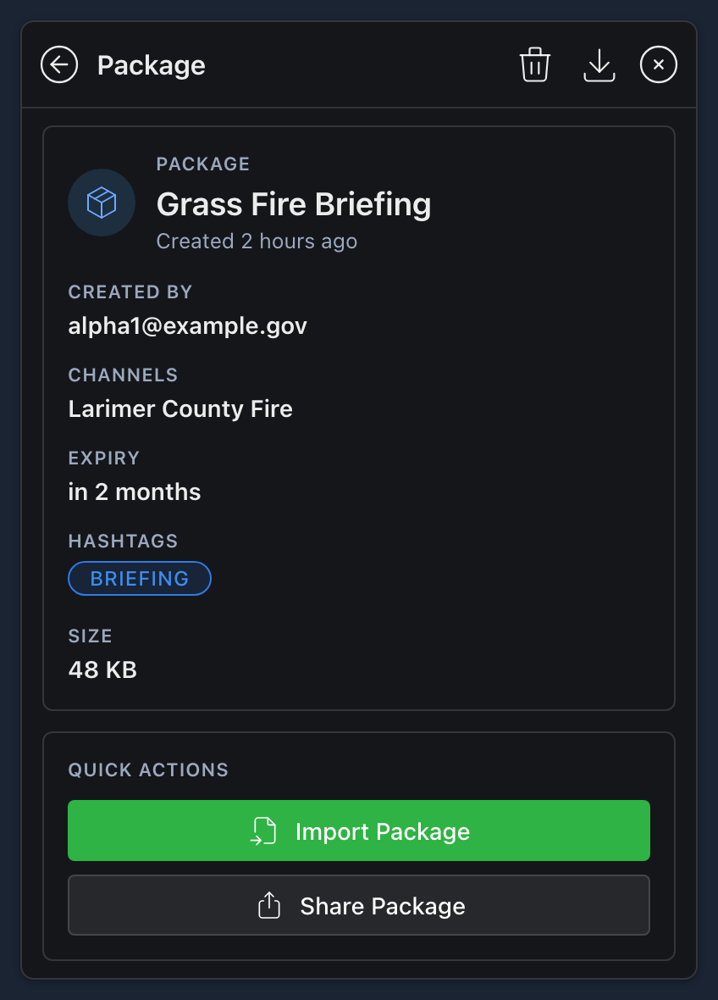

3. The import opens when it's done. Under **Import Results**, select a result to go to it: features go to your [Features](#features), and files, such as a KMZ, go to your [Files](#files), where you can add them to the map.

    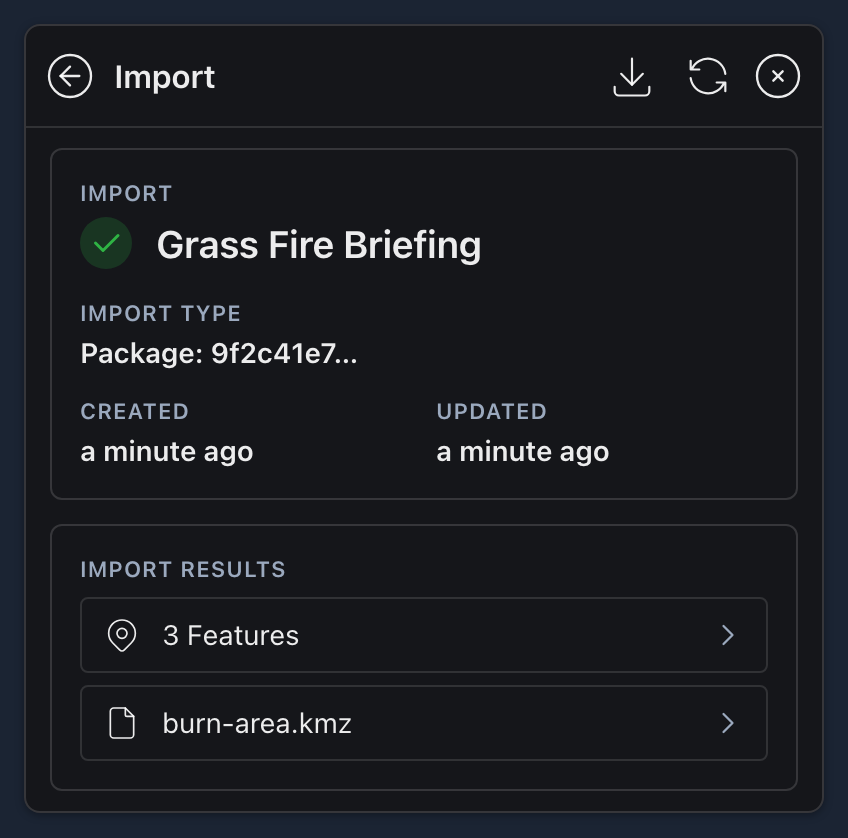

</Steps>

## Data Sync

Sending a feature straight to someone works, but it has limits. It's a one-time transfer: if the feature changes, nobody sees the update unless you send it again, and if you delete it, it's only gone from your map. It also only reaches people who are connected when you send it. Anyone out of coverage or with the app closed never gets it.

A Data Sync solves both problems. Instead of a single transfer, it's a live feed of map data hosted on the TAK Server. Everyone subscribed sees the same features and files, and every addition, change and removal reaches them as it happens, or the next time they open the app.

Data Syncs are used in two ways:

- **Feeds you view:** data your program or agency keeps updated automatically, such as wildland fire mapping or roadside cameras. You subscribe and watch.
- **Missions you build together:** Data Syncs that users create to map an incident together, or to keep track of points of interest in a response area. Anyone allowed to contribute can add, change and remove features, and everyone subscribed sees the changes without anyone resending them. This is the best way to keep shared data up to date during any ongoing operation.

### Subscribing to a Data Sync

Open the menu and select **Data Sync**. The **Subscribed** tab lists the Data Syncs you're subscribed to, and the **Available** tab lists the ones you can subscribe to. A lock means the Data Sync is password protected.

Every Data Sync belongs to a channel, and it's only listed when that channel is turned on. If you can't find a Data Sync you're looking for, check your [Channels](#channels) first. Many statewide feeds, for example, are on statewide mutual aid channels.

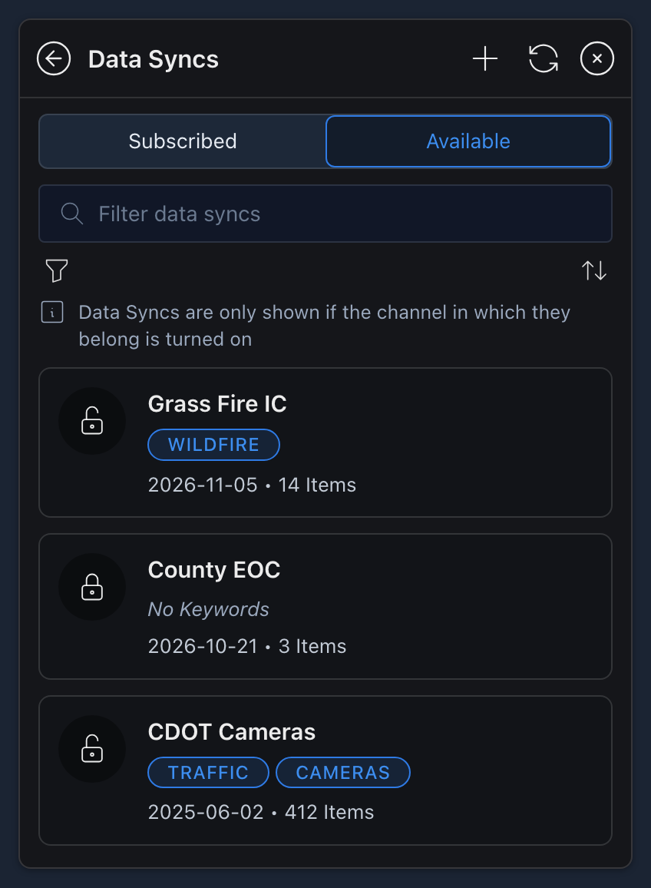

<Steps>

1. On the **Available** tab, select the Data Sync. If it's password protected, enter the password and select **Unlock**.

2. Under **Quick Actions**, select **Subscribe**. Everything in the Data Sync now appears live on your map.

    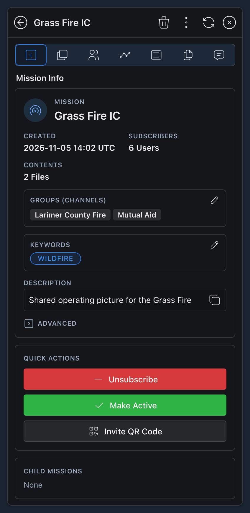

3. To remove the Data Sync and its features from your map, select **Unsubscribe**.

</Steps>

You can subscribe to as many Data Syncs as you like.

### Contributing to a Mission

Subscribing and contributing are two different things. Subscribing only receives what's in a Data Sync. To contribute, you make it your **active mission**.

<Steps>

1. Open the Data Sync and, under **Quick Actions**, select **Make Active**. You can only have one active mission at a time.

2. The top left of the map changes from **No Active Mission** to the Data Sync's name. From now on, anything you draw goes into the mission for everyone subscribed.

    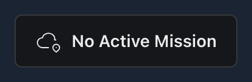

    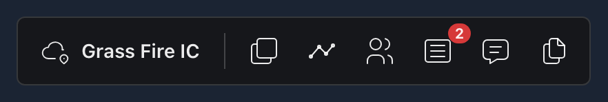

3. Select the name at the top left at any time to open the mission's page. See [The Data Sync Page](#the-data-sync-page).

</Steps>

**Deactivate** doesn't unsubscribe you. You keep receiving the Data Sync, but what you draw stays on your own map. Deactivate when you want to switch to a different mission, or to place something on the map without sharing it with everyone.

**Make Active** can't be selected on Data Syncs you can only view, such as camera feeds.

Use missions however works best for your team: one mission for all your operations, or a new one for each. Either way, each person needs to subscribe to the mission to see it.

### The Data Sync Page

Select a Data Sync you're subscribed to, or its name at the top left of the map, to open its page. The tabs along the top are:

- **Metadata:** when it was created, how many people are subscribed, its channels, keywords and description. **Advanced** shows the default role and whether it has a password. If you're allowed to, select the pencil next to the channels or keywords to change them. **Quick Actions** has **Subscribe** or **Unsubscribe**, **Make Active** or **Deactivate**, and an **Invite QR Code** others can scan to join.
- **Layers:** every feature in the Data Sync, which can be organized into layers.
- **Users:** everyone subscribed. Select **Invite User** to invite someone. If you're an owner, you can also change someone's role with the pencil or remove them with the trash can.
- **Changes:** a log of features and files added and removed, with the date and time of each change.
- **Logs:** written notes about the mission. Type an entry, add keywords if you like, and select **Save Log**. Select **Download Logs** to save them all as a CSV file.
- **Files:** files added to the Data Sync.
- **Chats:** a chat for everyone subscribed.

On a computer, the bar at the top left of the map also has shortcuts to these tabs for your active mission. A red number on **Logs** or **Chats** shows how many you haven't read.

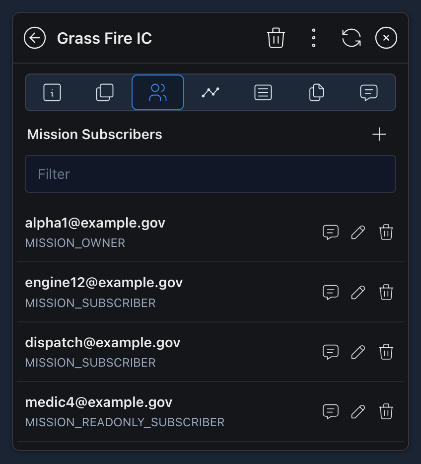

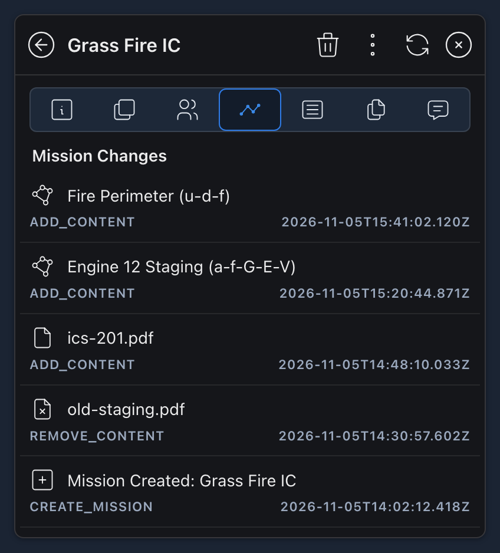

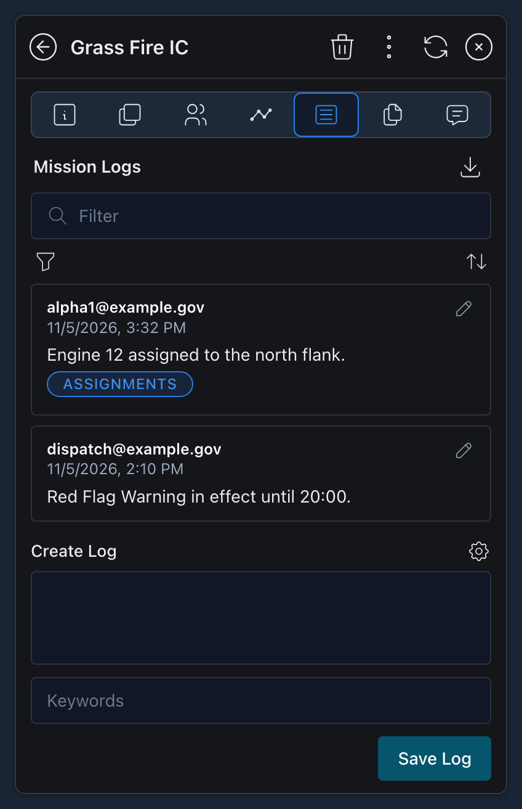

The three dots at the top of the page can export the Data Sync as a Data Package, GeoJSON or KML, or download it as an archive. Owners also have a trash can to delete the Data Sync.

### Creating a Mission

Anyone can create a Data Sync mission.

<Steps>

1. In the Data Syncs menu, select **Create Sync** at the top.

2. In the **Create Mission** window, give it a **Name** and **Description**, and choose the **Channels** it's on. Only channels you currently have turned on are listed. The channel controls who can find the mission to subscribe, and it's the main way its contents stay secure. If your server has templates, you can also start from one.

3. Open **Advanced Options** if you need them:

    - **Keywords** help others find it.
    - **Password Protected** means only people with the password can subscribe.
    - **Default Subscriber Role** sets what people can do once they subscribe:
        - **Subscriber** (the default): they can subscribe, make it active and contribute, but can't delete it or change who's in charge.
        - **Owner:** everyone who subscribes gets full control, including deleting it.
        - **Read-Only:** they can subscribe and view it, but only you can change it.

4. Select **Create Mission**. It opens on its **Metadata** tab, ready for you to **Make Active**.

    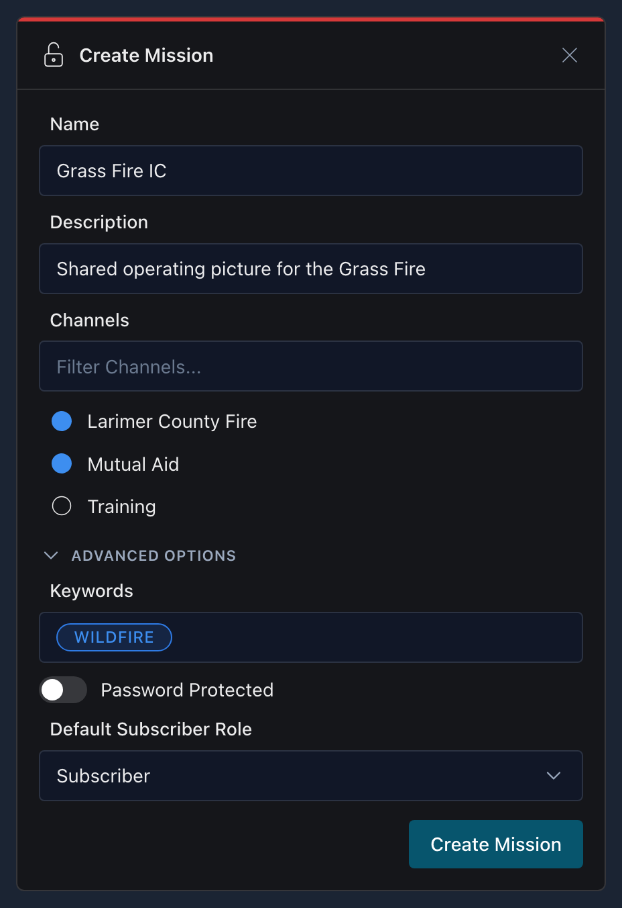

</Steps>

### Adding Data to a Mission

There are two ways to get features into a mission:

- **Make it active.** Everything you draw from then on goes straight into it. See [Contributing to a Mission](#contributing-to-a-mission).
- **Share features already on your map.** Open a feature's details pane, select **Share**, then the **Data Syncs** tab. Select the mission and select **Share**. The feature now lives in the mission instead of only on your device. See [Sharing Features](#sharing-features).

To add several features at once, select them with [Lasso Select](#lasso-select), then select **Share**, or select the three dots and **Move to Data Sync**.

The **Data Syncs** tab only lists missions you're allowed to contribute to, so read-only ones don't appear. If you later unsubscribe from a mission, or it's deleted, the features you added to it leave your map along with it.

## Settings

 Open the menu and select **Settings**.

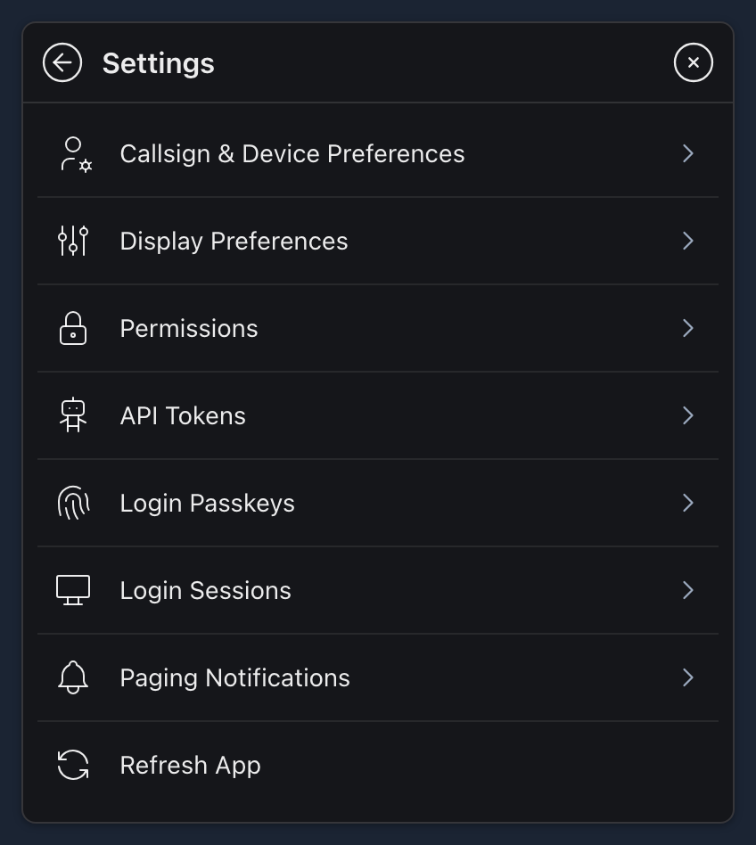

- **Callsign & Device Preferences:** your **User Callsign**, **Phone Number**, **User Group** (your team color) and **User Role**, how often your location is reported, and your **Default Point Type** for new points.
- **Display Preferences:** units for distance, area, elevation, speed and radiation dose, coordinate format, map projection, light or dark style, text size, zoom controls, keeping the screen awake, rotating icons with their course, and removing stale features.
- **Permissions:** what CloudTAK is allowed to use on this device, such as your location, notifications and camera. See [Allow Location and Notifications](#allow-location-and-notifications).
- **API Tokens:** tokens for connecting other tools to your account.
- **Login Passkeys** and **Login Sessions:** sign in with a passkey, and see or end the places you're signed in.
- **Paging Notifications:** where you get pages: by text message, by email, or as notifications on devices you register.
- **Refresh App:** reload CloudTAK.

## Glossary

**Affiliation:** whether a point is **Friendly**, **Hostile**, **Neutral** or **Unknown**, so anyone looking at the map can tell at a glance whose side something is on. In public safety terms, friendly is usually your own and partner resources, hostile is a threat, neutral is something not involved, such as a hospital or shelter, and unknown is anything not identified yet.

TAK uses military symbols (MIL-STD-2525) because they're a shared standard: every TAK user, in any agency, reads them the same way. The affiliation sets the frame's color and shape: a blue rectangle for friendly, a red diamond for hostile, a green square for neutral and a yellow clover for unknown. The shape matters as much as the color, so the symbols still read in low light, in black and white, or for colorblind users. See [Changing a Feature's Appearance](#changing-a-features-appearance).

**Basemap and overlay:** the basemap is the map underneath everything else, such as satellite imagery or streets. Overlays are layers drawn on top of it, such as weather radar, boundaries or a file you uploaded. See [BaseMaps](#basemaps) and [Overlays](#overlays).

**Breadcrumb trail:** the path a person or vehicle has taken, drawn as a line behind them. See [History](#history).

**Callsign:** the name other users see for you on the map and in chats. See [Callsign](#callsign).

**Channel:** a group on the TAK Server. The channels you turn on decide who can see your location and what data you see, such as your agency's units or aircraft positions. See [Channels](#channels).

**Coordinates:** a location written as numbers. CloudTAK can show them as decimal degrees (DD), degrees and minutes (DM), degrees, minutes and seconds (DMS), MGRS or UTM. See [Coordinates](#coordinates).

**Data Package:** a one-time bundle of features and files shared on a channel. Unlike a Data Sync, it doesn't update after it's shared. See [Data Packages](#data-packages).

**Data Sync:** a live feed of features and files on the TAK Server. Everyone subscribed sees the same data, and changes reach them without anyone resending it. Some Data Syncs are feeds you only view, such as fire mapping or cameras. Others are **missions** that users build together, and the mission you're adding features to is your **active mission**. See [Data Sync](#data-sync).

**Event:** a shared record of an incident, such as a wildfire or a search, that a team works from together. See [Create Event](#create-event).

**Feature:** anything on the map you can select. A feature is a **point** (a single spot, like a marker or a person), a **line** (like a route or a dozer line) or a **polygon** (a closed shape, like a fire perimeter). See [Working with Map Features](#working-with-map-features).

**Import:** uploading a file, such as a KML or a Shapefile, so CloudTAK can turn it into features, an overlay or icons. See [Uploading a File](#uploading-a-file).

**Saved and stale:** a feature goes stale when it stops updating, such as when a user goes offline. Stale features fade, then drop off your map after the time set in **Remove Stale Elements** in Display Preferences. Saved features, like the ones you draw, never go stale. See [The Details Pane](#the-details-pane).

**TAK:** short for Team Awareness Kit. The **TAK app** is what you use to see the map and share your location, such as CloudTAK. The **TAK Server** connects everyone's apps and passes data between them, so users on different devices and apps see each other.

**Team color and role:** your team color is the color of your dot on other users' maps, and your role is your job on the team, such as Medic. Set both in **Callsign & Device Preferences**. See [Settings](#settings).

**Video lease:** what lets you stream your own video, such as from a drone, so you and other TAK users can watch it. See [Videos](#videos).
